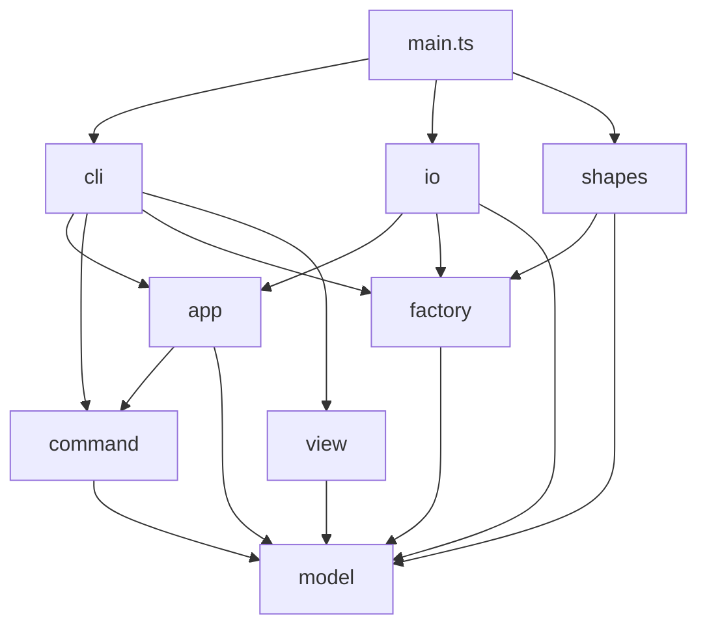
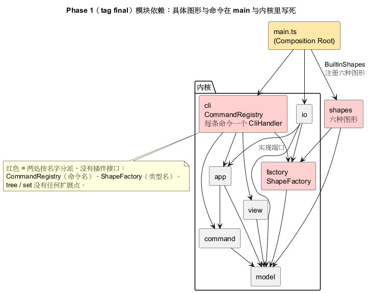
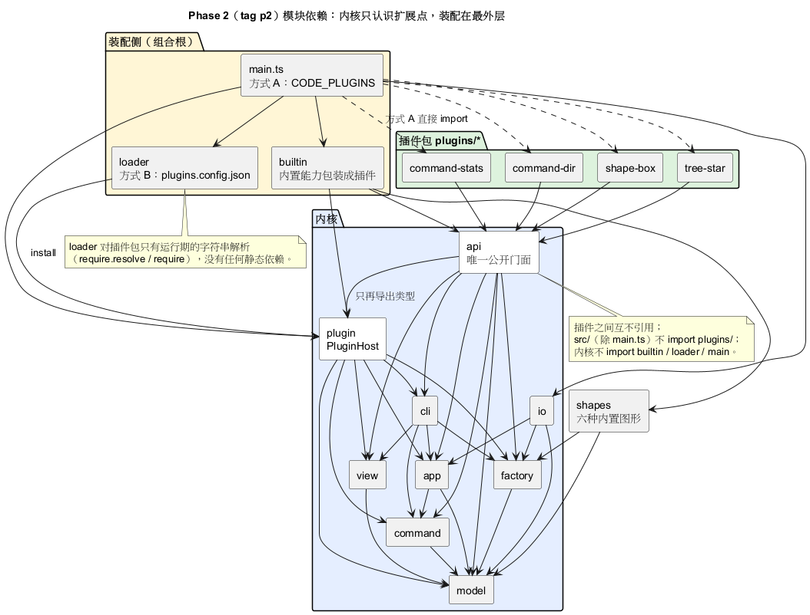
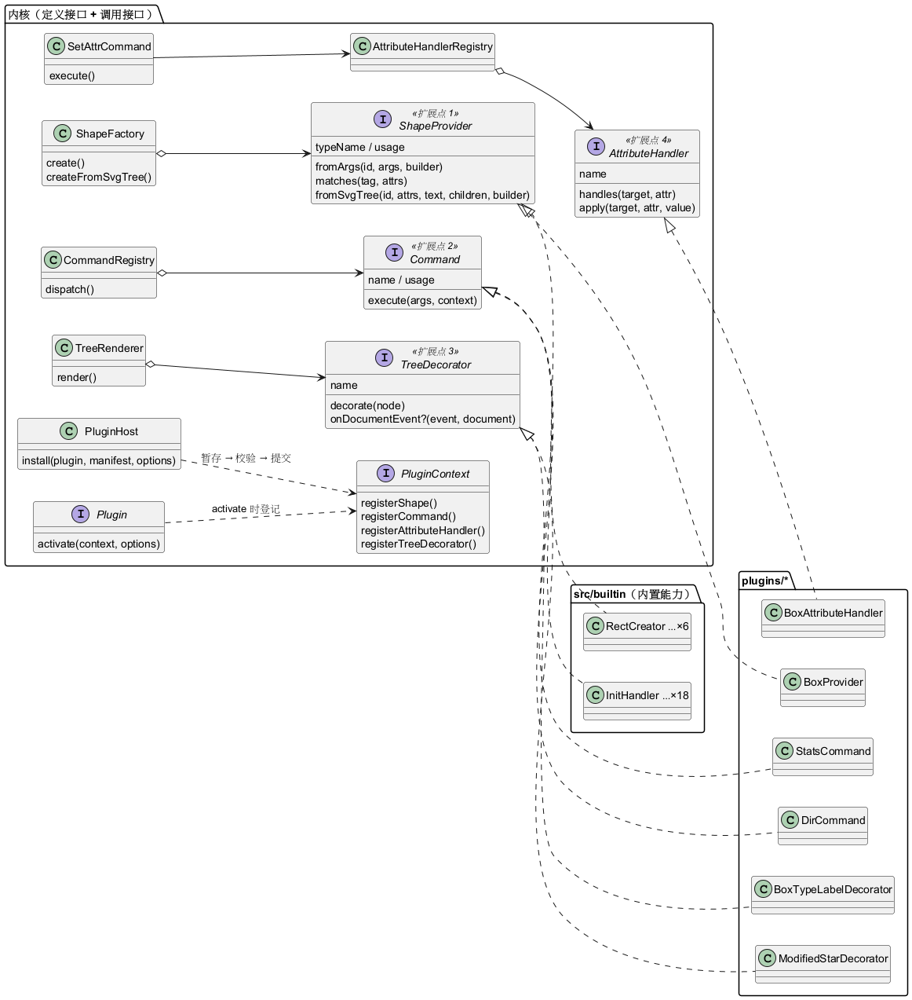
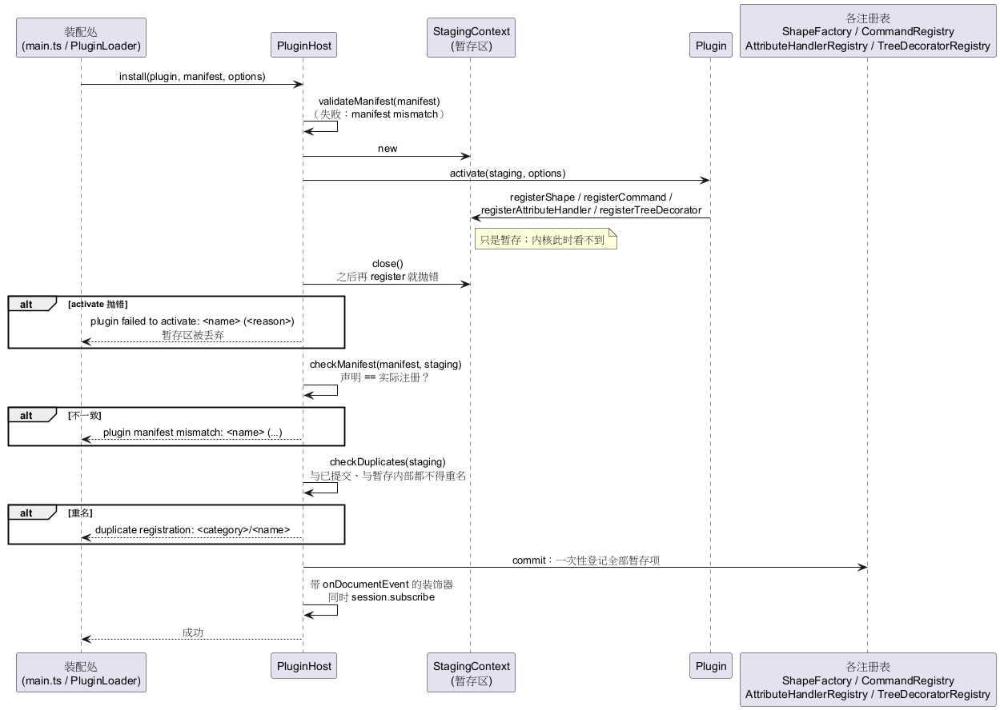
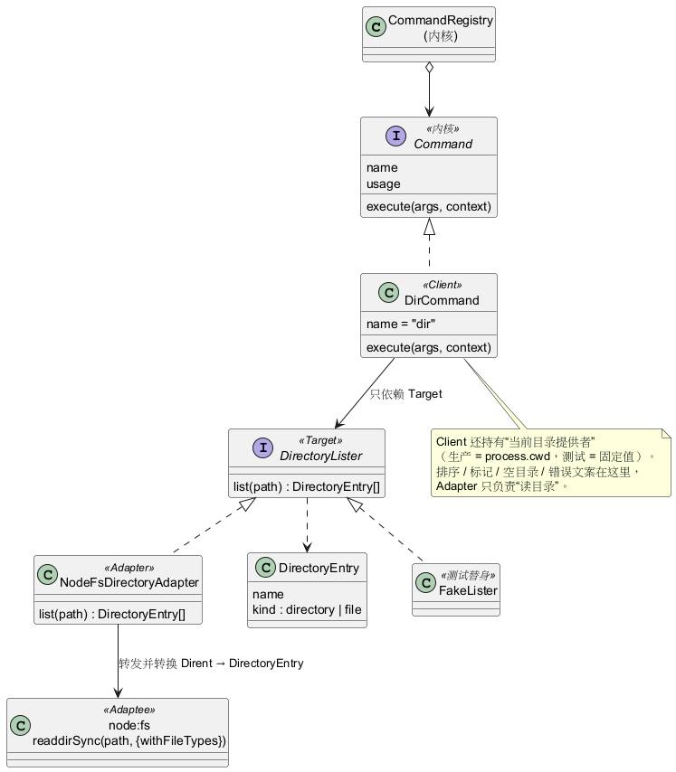

# Lab1 Phase 2：插件实践与插件式重构

> **阅读指引**
>
> - 「架构方案」「过程记录」「一致性自查」「质量保证手段」四节是 **Phase 1（tag `final`）** 的设计记录，保留作为重构前的基线。其中标注“待重构”的两处按名字分派、`ShapeCreator`、`CliHandler`、“只有 `main.ts` 引用 `shapes/`”等描述，已被第二部分取代；新旧名称的对应见 [Phase 1 到 Phase 2 的名称对照](#phase-1-到-phase-2-的名称对照)。
> - 「Lab2 新增内容」的**第一部分**是 VSCode 插件实践及 A.3 的分析；**第二部分**是 CLI 插件式重构（扩展点清单、装配说明、重构前后依赖图、ADR、`dir` 适配器说明、迭代报告）。
> - 复现所有结论只需要四条命令：`npm run build`、`npm test`、`npm run lint:deps`、`npm run metrics`（见[验证证据](#8-验证证据)）。

## 架构方案

### 1. 模块划分

采用两级划分：第一级是**层**，依赖方向规则按层书写；层内再按内聚程度分**子模块**。具体图形类型单独成为一个纵向模块 `shapes/`，每种类型的“图形类 + 创建器”放在一起。

```text
src/
  model/                内核：图形树 + 文档（不依赖其他任何模块，不认识任何具体图形类型）
    error/              领域错误：EditorError 基类、IdExists、NoSuchShape、NotContainer …
    shape/              Shape、GeometryShape、GroupShape、Numbers
    document/           SvgDocument、IdIndex、Placement
  factory/              图形工厂：类型名 -> 创建器的注册表（第 2 处按名字分派）
    error/              UnknownShapeType、InvalidArguments
  shapes/               内置图形，每种类型一个子模块（图形类 + 创建器）
    rect/ circle/ ellipse/ line/ text/ group/
    BuiltinShapes.ts    把 6 种内置类型注册进 ShapeFactory
  command/              编辑命令 + 撤销历史（Command 模式）
    edit/               各具体命令
    history/            EditCommand 接口、CommandHistory
    error/              group/ungroup/scale/undo 相关错误
  app/                  编辑会话外观 + 端口接口（Facade，依赖倒置）
    error/              NoDocument、FileError
  io/                   SVG 解析/序列化 + 文件读写（实现 app 的端口）
  view/                 tree/show 文本渲染（基于图形自描述）
  cli/                  REPL、分词、命令名分派（第 1 处按名字分派）
    handler/            每条 CLI 命令一个 CliHandler
  main.ts               组装入口（Composition Root）
```

错误类就近放在抛出它的层：只有被多层共用的领域错误留在 `model/error/`。所有错误都继承 `EditorError`，CLI 只按 `Error` 统一打印，不需要认识具体错误类。

#### 各模块职责

- **model**（内核）
  - `shape/Shape`（抽象类，Composite 中的 Component），提供：
    - 身份与结构：`id`、`parent`、`children()`（叶子返回空列表，使容器与叶子可被统一遍历）。
    - 统一操作：`move(dx,dy)`、`scale(f)`、`setAttr/getAttr`、`attrNames()`（`set` 命令的白名单）。
    - **自描述（供序列化）**：`tagName`（SVG 标签名）、`attributes()`（按序输出的 SVG 属性键值对）、`textContent()`（`<text>` 的文本内容，其余类型返回 `undefined`）。
    - **自描述（供显示）**：`summary()`（`tree` 一行中 `tag#id` 之后的属性摘要，如 `x=0 y=0 w=800 h=600 fill=#ffffff`；`g` 返回空串，`box` 插件返回 `(box)`）、`detailLines()`（`show` 输出的属性明细行）。
    - 容器操作 `insertChild/removeChild/indexOf` 也声明在 `Shape` 上（透明式 Composite），叶子调用时抛 `not a container`。
  - `shape/GeometryShape`：带数值几何属性的叶子基类，统一实现 move / scale / 属性读写，子类只声明属性名。
  - `shape/GroupShape`（Composite）：管理子节点的插入、摘出和 z-order；`move/scale` 递归作用到子节点。它属于内核，因为文档根节点就是一个 `GroupShape`。
  - `document/SvgDocument`：包含画布尺寸、根节点和 `IdIndex`，所有改变树结构的操作（insert / detach / relocate）都经过它，由它统一维护 id 唯一性。
  - `error/`：领域错误，只带消息，不带 `error:` 前缀。
  - 约束：不出现 `console`、`fs`、`readline`，也不出现 `switch(tag)`；内部依赖方向为 `document -> shape -> error`。
- **factory**（注册表）
  - `ShapeCreator` 接口：`typeName`、`usage`、`fromArgs(id, args)`（给 CLI 的 `create` 用）、`fromSvg(id, attrs, text)`（给读入 SVG 用）。
  - `AbstractShapeCreator`：模板方法基类，约定参数 = 若干数值几何参数 + 可选的一个样式参数。
  - `ShapeFactory`：用 `Map<string, ShapeCreator>` 注册和查找，查不到时抛出 `unknown shape type`。它本身不认识任何具体类型。
  - 第 2 处按名字分派，**待重构**；是后续 `ShapeProvider` 插件的插槽雏形。
- **shapes**（内置图形）
  - `rect/`、`circle/`、`ellipse/`、`line/`、`text/`：各自包含 `XxxShape`（继承 `GeometryShape`）与 `XxxCreator`（继承 `AbstractShapeCreator`）。
  - `group/`：只有 `GroupCreator`（`GroupShape` 在内核）。
  - `BuiltinShapes`：把 6 种类型注册进 `ShapeFactory`，只由 `main.ts` 调用。
  - 新增类型（如 `box`）= 新增一个子目录 + 在 `main.ts` 注册一行，内核零改动。
- **command**
  - `history/EditCommand` 接口：`execute(): string`（返回成功摘要）、`undo(): string`、`redo(): string`。
  - `edit/` 中的具体命令：`CreateCommand`、`DeleteCommand`、`MoveCommand`、`ScaleCommand`、`SetAttrCommand`、`GroupCommand`、`UngroupCommand`、`AddToCommand`、`ZOrderCommand`。
  - 所有校验在修改状态之前完成，保证“失败不改变状态”；`group` 等涉及多个图形的命令整体作为一个 undo 单元。
  - `history/CommandHistory`：管理 undo/redo 两个栈，执行新命令时清空 redo 栈。`lockByIo()` 清空两个栈并禁止撤销，下一次成功的 `execute` 自动解除锁定。
- **app**
  - `EditorSession`（Facade）：持有当前文档、`CommandHistory` 和当前文件路径；提供 `init/read/save/canvas` 四个文档类操作，`execute(cmd)`、`undo()`、`redo()`，以及“无文档”检查。
  - 端口接口：`DocumentReader`、`DocumentWriter`（输入输出为 `SvgDocument` 和路径）、`WarningSink`（接收“自动补 id”警告）。
- **io**
  - `SvgParser`：把 XML 解析成 model，通过 `ShapeFactory.createFromSvg` 构建图形，缺 id 时补成 `标签名+序号` 并发出警告。
  - `SvgSerializer`：**通用序列化器**，只依赖 `Shape` 的自描述接口（`tagName`、`attributes()`、`textContent()`、`children()`）递归输出 SVG，不认识任何具体图形类。
  - `FileDocumentStore`：实现 app 中的端口，用 `fs` 读写文件，并转换 `cannot read/write file` 错误。
- **view**
  - `TreeRenderer`：递归遍历 `children()`，负责树形连接符（`├──`、`└──`）、缩进和列对齐，每行内容取自 `tagName`、`id` 和 `summary()`。
  - `ShowRenderer`：输出 `tag#id  parent=…` 头行，之后逐行输出 `detailLines()`。
  - 两者都只使用 `Shape` 的自描述接口，不认识任何具体图形类；只负责“怎么排版”，不负责“图形显示什么”。
- **cli**
  - `Repl`：基于 readline，处理 `svg>` 提示符和 `#` 注释。
  - `Tokenizer`：处理双引号包裹的参数。
  - `CommandRegistry`：命令名到 `CliHandler` 的映射。第 1 处按名字分派，**待重构**。
  - `handler/` 中每个 `CliHandler` 负责解析参数、构建 `EditCommand`（通过 factory 创建图形），再交给 session 执行。
  - `ConsoleOutput`：统一加上 `error:` / `warning:` 前缀。

#### 包图（PlantUML）


### 2. 设计模式的选择

课程要求使用 Command。实现中还用了 Composite、Factory、模板方法和 Facade；文件读写通过 app 自己定义的端口做依赖倒置。序列化和 `tree` / `show` 不使用 Visitor，为图形自描述。


| 模式        | 角色在代码中的位置                                                                                                            |
| --------- | -------------------------------------------------------------------------------------------------------------------- |
| Command   | `EditCommand` 是命令；`command/edit/` 下 9 个类是具体命令；`SvgDocument` 和 `Shape` 是接收者；`CommandHistory` 是调用者；`cli/handler/` 是客户端 |
| Composite | `Shape` 是组件，`GroupShape` 是容器，`RectShape` 等叶子经 `GeometryShape` 实现同一套操作                                                |
| Factory   | `ShapeCreator` 是每种类型的工厂，`ShapeFactory` 是按类型名查找的注册表                                                                   |
| 模板方法      | `AbstractShapeCreator` 固定“解析参数再构建”的骨架；`GeometryShape` 固定几何属性的移动、缩放和读写                                                |
| Facade    | `EditorSession` 把当前文档、历史、文件路径和“有没有文档”收成一个入口                                                                          |
| 依赖倒置      | `DocumentReader`、`DocumentWriter`、`WarningSink` 由 app 定义，`FileDocumentStore` 和 `ConsoleOutput` 在外层实现                 |


#### Command

下面以 `move` 为例。其余 8 个具体命令的结构相同，只是转发给接收者的方法不同。


一条编辑命令是一个 undo 单元。`EditCommand` 只有 `execute`、`undo`、`redo`，返回成功摘要，不写控制台。`MoveCommand`、`DeleteCommand`、`GroupCommand` 等各自保存撤销所需的快照：移动和缩放保存几何值，删除和编组保存原来的父节点与下标。`group` 即使收编多个图形，也只生成一个 `GroupCommand`，撤销一次就全部还原。

`CommandHistory` 不认识任何具体命令。它先调用 `execute`，成功后才压入 undo 栈并清空 redo 栈；执行中抛出的错误不会入栈，因此失败命令不改变历史。`init`、`read`、成功的 `save` 和修改尺寸的 `canvas` 调用 `lockByIo()`，清空两个栈并禁止跨越这次文档操作撤销。下一条成功的编辑命令会自动解除锁定，并成为新的历史起点。

CLI 处理器只解析参数并构造命令。例如 `MoveHandler` 把文本变成数字后，通过 `EditorSession.execute` 得到当前文档，再创建 `MoveCommand`。会话负责检查“是否已有文档”，历史负责入栈，命令负责修改图形。以后 GUI 可以复用同一批命令，不必经过文本解析。

#### Composite

下面以 `move` 为例。`circle`、`ellipse`、`line`、`text` 与 `RectShape` 相同，都经 `GeometryShape` 实现 `move`。


`Shape` 同时声明叶子和容器都会用到的操作：`move`、`scale`、`setAttr`，以及 `children()`、`insertChild`、`removeChild`。这是透明式 Composite。叶子的 `children()` 返回空列表，对叶子调用插入或摘除会抛出 `not a container`。因此 `DeleteCommand`、`TreeRenderer` 和 `SvgSerializer` 都可以只依赖 `Shape`，不必判断对象是矩形还是分组。

`GroupShape.move` 和 `scale` 递归到每个子节点，所以 `move node2 0 100` 会带动组内的矩形和文字。文档根节点也是一个 `GroupShape`，但它表示 `<svg>` 本身，不进入 id 索引，也不能被 `ungroup`。`isComposite()` 预留给 `box` 这类内部结构归插件所有的容器；当前内置的 `g` 返回 `false`，`UngroupCommand` 遇到 `true` 时拒绝解散。

#### Factory 与模板方法

下面以 `create rect` 为例。`circle`、`ellipse`、`line`、`g` 与 `RectCreator` 相同，只实现 `build`。


创建图形有两个入口，但都落到同一个 `ShapeCreator`：`fromArgs` 服务 CLI 的 `create`，`fromSvg` 服务读入 SVG。`ShapeFactory` 用 `Map<string, ShapeCreator>` 按类型名查找，找不到就抛出 `unknown shape type`。工厂本身不引用 `RectShape` 等具体类。六种内置类型由 `BuiltinShapes` 注册，而 `BuiltinShapes` 只允许 `main.ts` 引用。

`AbstractShapeCreator` 把重复流程固定下来：检查参数个数、把几何参数解析成数字、调用子类的 `build`，再按类型写入可选的 `fill` 或 `stroke`。`RectCreator`、`CircleCreator` 等只声明属性名并实现 `build`。`text` 的第三个参数是字符串内容，不符合这个数值模板，所以 `TextCreator` 覆盖了 `fromArgs`，读入 SVG 时仍复用基类的 `fromSvg`。

`GeometryShape` 是另一处模板方法。它按 SVG 属性名保存数值，统一实现移动、缩放、属性读写和序列化；具体叶子只声明哪些键属于 x 或 y。这样新增一种普通几何图形时，不需要再写一遍 `move` 和 `setAttr`。

`ShapeFactory` 和 CLI 的 `CommandRegistry` 是全项目仅有的两处按名字分派，代码里都标注为待重构。它们现在是可替换实现的注册表，还不是能够动态加载的插件框架。

#### Facade 与依赖倒置

下面以 `read` 为例。`init`、`save`、`canvas`、`execute`、`undo`、`redo` 也同样只从 `EditorSession` 进入。


`EditorSession` 是外层访问编辑器的唯一入口。它隐藏了三件易变的事：当前文档可能不存在、撤销栈何时被文档操作锁住、文件路径是显式传入还是沿用上次的路径。`init`、`read`、`save`、`canvas`、`execute`、`undo`、`redo` 都从这里进入。`tree` 和 `show` 不修改状态，通过 `inspect` 只读访问文档。

会话不直接依赖文件系统。它依赖自己声明的 `DocumentReader`、`DocumentWriter` 和 `WarningSink`。`FileDocumentStore` 用 `fs` 实现前两个端口，并把系统错误转换成 `cannot read file` 或 `cannot write file`；XML 内容错误则原样抛出，不伪装成文件错误。`ConsoleOutput` 同时实现 CLI 的 `TextOutput` 和 `WarningSink`，统一添加 `error:` 与 `warning:` 前缀。测试可以用内存桩替换这些实现，app 和 command 都不用改。

### 3. 依赖方向规则

箭头表示“可以依赖”，图中没有的依赖一律禁止：




1. **model 不依赖任何模块**，也不引用 Node 内置模块。理由：图形树会被 CLI、agent、鼠标三种通道共用，必须保持纯净，便于单元测试。model 内部依赖方向为 `document -> shape -> error`：图形不知道文档的存在，错误类不依赖任何东西。
2. **command 只依赖 model**。命令不关心来源是文本还是鼠标，也不做任何输出。理由：以后 GUI 可以直接复用。
3. **app 只依赖 model 和 command，通过自己定义的端口接口使用 IO**，不能 import io。理由：依赖倒置，文件、网络、内存存储都可替换，测试时可注入假实现。
4. **io 依赖 app 的端口和 model/factory，属于最外层的“插件”**，不允许被 app、command、model 引用。io 只通过 `Shape` 的自描述接口读取图形，不依赖任何具体图形子类。
5. **view 只依赖 model**，通过 `Shape` 的自描述接口只读遍历图形树，不修改状态。
6. **cli 位于最外层**，可依赖 app、command、factory、view，但不能直接 import io，也不能绕过 session 直接修改 model。
7. **只有 main.ts 可以同时看到所有模块，也只有它可以引用 shapes**，负责通过 `BuiltinShapes` 创建 `ShapeFactory`，以及创建 `FileDocumentStore`、`EditorSession` 和 `Repl` 并连接。理由：这是“内核不认识具体图形类型”的机械保证——io、view、command、cli 一旦 import `RectShape` 这类具体类就会被检查拦下。
8. **shapes 只依赖 factory 和 model，各图形子模块之间互不引用**。理由：每种图形是一个可单独增删的单元，为插件化阶段做准备。
9. **全局不允许循环依赖**；同一模块内部可以互相引用。
10. 按名字分派只允许出现在 `cli/CommandRegistry` 和 `factory/ShapeFactory` 两处。

检查手段：`dependency-cruiser`，规则见 `.dependency-cruiser.cjs`，执行 `npm run lint:deps`。

### 4. 变化点假设

- **新增图形类型（如** `box` **插件）**：新增 `shapes/box/` 子模块并在 `main.ts` 注册即可。序列化与 tree/show 显示都已改为图形自描述，序列化器和渲染器无需修改；`box` 的 `data-kind` 标记由其 `attributes()` 输出，`g#n1 (box)` 的类型标注由其 `summary()` 输出。代价是 model 中的 `Shape` 需要知道 SVG 的标签名和属性名，并且承担了一部分显示文本的职责，即 SVG 词汇和显示格式进入了 model。决定接受这一点：SVG 本身就是本领域的原生格式，不为“可能换成别的格式”预留抽象。
- **显示文本的职责边界**：`summary()`/`detailLines()` 返回的是 CLI 文本。若以后有 GUI 需要结构化属性展示，可改为返回键值对，由各通道自行排版；目前 CLI 是唯一通道，暂不预留。
- **命令直接返回摘要字符串**：简单，但一部分展示职责落在了 command。若以后要多语言或有 GUI，可改成结构化的 `CommandResult`。
- **暂不引入 Observer**：CLI 不需要；GUI 阶段需要刷新画面时，再在 `SvgDocument` 上加事件。
- **新增 CLI 命令**：加一个 `command/edit` 中的命令类和一个 `cli/handler`，再在 `Cli.createDefault` 里 `register` 一行。命令只改 model，处理器只解析参数并交给 `EditorSession`。`CommandRegistry` 与 `ShapeFactory` 一样仍是按名字分派，代码中标注为待重构。
- **另一种输入通道（GUI、agent）**：`EditCommand` 不解析文本、也不写控制台，`EditorSession` 是访问当前文档和历史的唯一入口，因此新通道可以复用同一批命令。鼠标点选和命中检测当前不存在，没有为它们预留接口。
- **存储介质**：`DocumentReader`、`DocumentWriter` 由 app 定义，`FileDocumentStore` 只是用 `fs` 做的一种实现。换成内存或网络存储时，替换注入给 `EditorSession` 的实现即可，app 和 command 不用改。

## 过程记录

- **序列化方案由 Visitor 改为图形自描述**：AI 给出的初稿选用 Visitor，同时在取舍中指出它与 `box` 插件化（内核新增代码为 0）的目标冲突。复核后决定在方案阶段就改为自描述，避免后期重构。起初 view 仍保留 Visitor（每种图形的显示格式不同），但这会让新增类型时仍需修改渲染器，与序列化改动的目的自相矛盾，随后也一并改为自描述（`summary()` / `detailLines()`），整个方案不再使用 Visitor。
- **从“只按层分”到“层 + 子模块 + 纵向的 shapes 模块”**：让 AI 实现完 model 和 factory 两层后发现，`model/` 一层堆了 28 个文件（图形内核、文档、17 个错误类混在一起），且同一种图形被拆在两层（`RectShape` 在 model、`RectCreator` 在 factory），新增类型要同时改两层，与插件化目标不符。于是重构为：层内按内聚分子模块；具体图形与其创建器合并为 `shapes/<type>/`，并新增“只有 main.ts 可以引用 shapes”的规则；错误类就近放到抛出它的层。之所以能加上这条规则，是因为此前已把序列化和显示改为图形自描述，io / view / command 本来就不需要认识具体图形类。重构后用临时违规文件验证了新规则全部生效。

## 一致性自查

- **模块划分**：`src/` 的目录与第 1 节一致。`model` 内是 `error`、`shape`、`document`；`shapes/` 下每种图形一个子目录，图形类与创建器放在一起；`GroupShape` 留在 `model/shape`，因为文档根就是一个组。`command` 分为 `edit`、`history`、`error`，`app` 只保留会话和端口，`cli/handler` 一条命令一个类。
- **依赖方向**：`npm run lint:deps` 通过。`.dependency-cruiser.cjs` 与第 3 节的规则对应，包括 model 不引用其他模块和 Node 内置模块、command 只依赖 model、app 不引用 io、cli 不引用 io 和 model、只有 `main.ts` 引用 `shapes/`、各图形子模块互不引用、没有循环依赖。
- **设计模式**：第 2 节列出的角色都在代码里。`command/edit/` 有 9 个具体命令，都实现 `EditCommand`；`CommandHistory` 只依赖这个接口。`Shape` 上声明了容器操作，叶子调用时抛出 `not a container`。`ShapeFactory` 不引用 `RectShape` 等具体类，六种内置类型由 `BuiltinShapes` 注册。`EditorSession` 是唯一入口，`FileDocumentStore` 实现 `DocumentReader` 和 `DocumentWriter`。序列化和 `tree` / `show` 只调用 `Shape` 的自描述方法，没有 Visitor。按名字分派只有 `CommandRegistry.dispatch` 和 `ShapeFactory` 的查找两处。
- **类图省略了会话**：Command 类图把 `MoveHandler` 直接画到 `CommandHistory`，用来标出客户端、调用者和命令。代码里处理器只调用 `EditorSession.execute`，再由会话进入历史栈。这条路径写在 Command 一节的正文和 Facade 图里。依赖方向以包图和 dependency-cruiser 为准，类图只表示一次调用里的模式角色。
- **一处文档与实现不符 (后面已改正)**：第 1 节写 `CommandHistory` 提供 `unlock()`。实现中没有这个方法。`lockByIo()` 清空两个栈，下一次成功的编辑命令在 `execute` 里解除锁定，并成为新的历史起点。

## 质量保证手段

三条命令覆盖测试、类型和依赖方向：`npm test`（vitest）、`npm run build`（`tsc`，`strict: true`）、`npm run lint:deps`（dependency-cruiser）。

- **TDD**：每一层先写测试并单独提交，确认失败后再写实现。因此提交历史上都是 `test(...)` 与 `feat(...)` 成对出现。测试目录与 `src/` 的层一一对应。
- **每层锁住的行为**：
  - model：图形树、id 唯一性、叶子不是容器、`move` / `scale` 的作用范围。
  - factory 与 shapes：注册表查不到类型时抛错；`fromArgs` 与 `fromSvg` 两条创建路径。
  - command：每条编辑命令的执行、撤销和重做；非法输入不改变文档；历史栈在文档操作之后锁定，失败的命令不入栈。
  - app：会话的 `init` / `read` / `save` / `execute`。`DocumentReader`、`DocumentWriter`、`WarningSink` 用桩替换，会话测试不碰文件系统。
  - io：SVG 解析与序列化，以及临时目录中的文件读写。
  - view：`tree` 的连接符与列对齐，`show` 的明细行。
  - cli：分词、`error:` / `warning:` 前缀、REPL 和命令分派。
- **实验会话回放**：`test/cli/Transcript.test.ts` 通过 `createCli` 回放两段会话，一段是完整的编辑、撤销和文件往返，一段是用组合作节点的流程图。断言的是 stdout 和 stderr 的全文。临时文件放在系统临时目录，不修改进程的工作目录。真实地在程序上运行实验会话回放，也得到了和要求文档中相同的结果。
- **依赖方向由工具检查**：`.dependency-cruiser.cjs` 把第 3 节的规则写成禁止项，包括禁止循环依赖、model 不引用 Node 内置模块、只有 `main.ts` 可以引用 `shapes/`。规则写好后用临时违规文件确认能被拦住，再删掉这些文件。


# Lab2 新增内容

## 第一部分：VSCode 插件实践

扩展放在 `vscode-extension/`，自带 `package.json`、依赖和编译产物，不改 Phase 1 的 `src/`。

它做两件事：在资源管理器里给 `.svg` 文件加上 `[]` 标记，并在大纲里按元素嵌套列出符号。

### 构建与启动

在 `vscode-extension` 目录执行：

```text
npm install
npm run compile
```

用 VS Code 打开 `vscode-extension` 目录，按 F5。调试配置 `Run Extension` 会先启动默认构建任务（`npm run watch`），再打开标题带「扩展开发宿主」的窗口。

> 若出现 正在等待 preLaunchTask"watch"... ，点"仍然调试"

`package.json` 的 `activationEvents` 是 `onStartupFinished`。宿主启动结束后调用 `activate`，在那里注册文件标记和文档符号两个 provider。

---

也可以打包后装进普通窗口：

```text
npx @vscode/vsce package
code --install-extension svg-vscode-0.1.0.vsix
```

---

示例文件是 `vscode-extension/examples/sample.svg`。

同一目录里还有 `example.svg`、`notes.txt`、普通目录 `assets`，以及名为 `x.svg` 的目录，用来对照哪些项会带标记。

### 安装扩展前的原生 Outline

在未加载本扩展的 VS Code 中打开 `vscode-extension/examples/sample.svg`。


- `example.svg` 右侧没有该标记
- 侧栏「大纲」只有一行：**活动编辑器无法提供大纲信息。** 没有 `svg` / `g` / `rect` 层级，也不能点击跳到某一行。

### 文件标记


扩展开发宿主的资源管理器里，`example.svg` 和 `sample.svg` 右侧是 `[]`，悬停提示为 `SVG file`。

`notes.txt`、目录 `assets`、名为 `x.svg` 的目录都没有这个标记。

`SvgFileDecorationProvider` 只处理 `file` 方案且扩展名（大小写不敏感）为 `.svg` 的路径，再用 `vscode.workspace.fs.stat` 排除目录。返回的 `FileDecoration` 只影响显示，不改文件名和内容。

### 大纲


`sample.svg` 用文本编辑器打开。大纲从根到叶子是 `svg`、`g#layer`、`g`、`rect#start` 和 `text`。有 `id` 的元素显示 `标签#id`，没有 `id` 的只显示标签名。

选中 `rect#start` 后，编辑器定位到第 4 行的 `<rect id="start" ...>`。

编辑文档后，宿主会重新调用 `provideDocumentSymbols`。provider 不保存文档或上次的符号。文本不良构，或解析过程中出现异常时，`SvgOutlineParser` 返回空数组，大纲清空，异常不抛到宿主外面。

### 职责划分与注册调用过程

**VS Code 负责资源管理器、大纲、文件系统事件、语言选择，以及何时向扩展要数据。**

**扩展负责回答两件事：这个资源要不要标记，这份文档的符号树是什么。**

`activate` 只做装配。`onStartupFinished` 触发后，它调用 `registerFileDecorationProvider` 和 `registerDocumentSymbolProvider`，并把返回的 disposable 放进 `context.subscriptions`。

`.svg` 的默认语言 id 是 `xml`，所以文档符号按文件名 `**/*.svg` 和 language id `svg` 各注册一次。之后宿主在画资源行时调用 `provideFileDecoration`，在打开或编辑文档时调用 `provideDocumentSymbols`。


### 与 Decorator、Adapter 的对应


|            | 文件标记                                         | 大纲                                                        |
| ---------- | -------------------------------------------- | --------------------------------------------------------- |
| 宿主接口       | `FileDecorationProvider`                     | `DocumentSymbolProvider`                                  |
| 插件对象       | `SvgFileDecorationProvider`                  | `SvgDocumentSymbolProvider`                               |
| 插件持有的对象    | 不持有资源节点                                      | 调用 `SvgOutlineParser`，读取 `OutlineNode`                    |
| 交回宿主的结果    | `FileDecoration` 或 `undefined`               | `DocumentSymbol[]`                                        |
| 模式         | 回调式扩展点                                       | Adapter                                                   |

文件标记在「给已有资源补一层显示信息、不改资源本身」上和 Decorator 的意图一致。结构上它不是经典 Decorator：插件对象和资源节点没有同一个接口，也不包裹资源再把调用转发出去。宿主保存 provider，画某一行时再回调；多个 provider 的 badge、tooltip、color 由宿主合并到同一个资源上。这是宿主定义的扩展点。策略决定这一行返回什么，刷新时机由宿主决定，调用关系更接近 Strategy 与 Observer 的组合。

---

大纲是 Adapter。Target 是 `DocumentSymbolProvider`，Client 是 VS Code，Adaptee 是 `SvgOutlineParser` 和它的 `OutlineNode`。`SvgDocumentSymbolProvider` 把文本解析成内部节点，再递归变成 `DocumentSymbol`：有子节点的用 `SymbolKind.Namespace`，叶子用 `SymbolKind.Field`。`range` 覆盖整个元素，`selectionRange` 覆盖标签名，所以点击落在标签所在行。适配解决的是接口不一致；文件标记解决的是在不改原对象的前提下附加显示。

### Phase 1 复用评估

| 模块                              | 结论   |
| ------------------------------- | ---- |
| `SvgParser`                     | 不直接复用 |
| `Shape` / `SvgDocument`         | 不复用  |
| `fast-xml-parser` 的良构校验         | 复用   |
| `tag#id` 的命名                    | 沿用约定 |

`SvgParser` 用 `fast-xml-parser` 的 `preserveOrder` 读出元素顺序，结果里没有源码行列。缺 id 时它分配 `标签名+序号`，并通过 `WarningSink` 发出警告，这会改掉大纲应显示的名字。非法 XML 抛 `InvalidValueError`，大纲需要的是空树。它还依赖 `ShapeFactory` 和 `SvgDocument`，会把 CLI 内核带进扩展。

`Shape` 和 `SvgDocument` 携带几何、画布和 id 索引。大纲只需要标签、id、嵌套和源码范围，几何语义用不到。可以借鉴的是 `Shape.label` 的 `tag#id` 写法，以及 `children()` 对容器和叶子的统一遍历。`Shape.label` 在缺 id 时仍然带 `#` 和自动编号；大纲对缺 id 的元素只显示标签名，因此不能原样调用这个 getter。

扩展因此另写了 `SvgOutlineParser`。它先用 `XMLValidator.validate` 判断良构，失败就返回 `[]`；通过后再用 `htmlparser2`（`xmlMode: true`）读取 `startIndex` / `endIndex`，自己把偏移量换成行列。解析不引用 `vscode`，异常也收成空数组。

若以后要让 CLI 和扩展共用一棵带位置的树，应在解析层增加位置信息：让 `SvgParser` 先产出带 range 的中间树，再由 CLI 映射成 `Shape`、由扩展映射成 `DocumentSymbol`。代价是改 `SvgParser` 的输出，并决定自动补 id 是否还留在这一层。当前两边的失败语义不同，这一层还不能直接合并。

### A.3 复核与验证证据

按 `phase_cli_2.md` 的 A.1–A.3 逐项对照，并对照扩展源码和测试复核了上文的陈述。

| 要求 | 本文位置 | 复核结果 |
| --- | --- | --- |
| 扩展源码、安装/启动步骤 | `vscode-extension/src/`；「构建与启动」 | 与 `package.json` 一致：`npm install`、`npm run compile`，F5 启动；`activationEvents` 为 `onStartupFinished`。 |
| 示例 SVG | `vscode-extension/examples/` | `sample.svg`（嵌套分组、无 id 的 `g` 与 `text`）、`example.svg`、`notes.txt`、目录 `assets` 与名为 `x.svg` 的目录，用来对照哪些项该有标记。 |
| 文件标记截图、大纲定位截图 | `images/vscode-svg-badge.jpg`、`images/vscode-svg-outline.jpg`，原生大纲对照 `images/vscode-native-outline.jpg` | 三张图都在仓库里。大纲截图选中 `rect#start`，对应 `sample.svg` 的第 4 行（需求示意图的示例文件少一层，所以显示第 3 行，行号以本仓库的 `sample.svg` 为准）。 |
| VSCode 与插件的职责、注册与调用过程 | 「职责划分与注册调用过程」与 `puml/png/vscodeExtension.png` | 与 `src/extension.ts` 一致：`activate` 只做两次 `register*`（文档符号按 `**/*.svg` 与 language id `svg` 各注册一次），返回值放进 `context.subscriptions`。 |
| 与 Decorator、Adapter 的对应和差异 | 「与 Decorator、Adapter 的对应」 | 与代码一致：`SvgFileDecorationProvider` 实现宿主的 `FileDecorationProvider`，不包裹资源节点，所以结构上不是经典 Decorator；`SvgDocumentSymbolProvider` 的 Target、Adaptee、Client 三个角色都能在代码中指出。 |
| 复用 Phase 1 的评估 | 「Phase 1 复用评估」 | 结论仍成立。Phase 2 中 `SvgParser` 改成“先递归构造子树、再整棵插入”，入口变为 `ShapeFactory.createFromSvgTree`，但仍然依赖 `ShapeFactory` 与 `SvgDocument`、缺 id 时补号并发警告、非法 XML 抛错而不是返回空树，所以不能直接复用的原因没有变。 |

A.2 要求的“测试至少覆盖嵌套分组、无 id 元素、编辑更新和不完整 XML”，以及 A.1 的“非 SVG 文件和目录不加标记”，对应下列测试。`vscode-extension` 目录里执行 `npx vitest run`，3 个文件共 15 个用例全部通过。

| 效果 | 测试 | 覆盖点 |
| --- | --- | --- |
| 嵌套分组 | `SvgOutlineParser.test.ts`：按嵌套建立 `svg > g > g > rect` | 层级与 `tag#id` 命名；`range` 与 `selectionRange` 都落在源码对应位置。 |
| 无 id 元素 | `SvgOutlineParser.test.ts`：没有 id 或 id 为空时只显示标签名 | 缺 id 与空 id 都只显示标签名。 |
| 点击定位 | `SvgOutlineParser.test.ts`：`selectionRange` 落在第 3 行的 `rect#start` 上；CRLF、跨行开始标签、`</g >` 三个边界用例 | `selectionRange` 覆盖标签名，`range` 覆盖整个元素。 |
| 编辑更新 | `SvgOutlineParser.test.ts`：同一个解析器对编辑前后的文本给出不同结果；`SvgDocumentSymbolProvider.test.ts`：连续调用不保留上一次结果 | provider 不缓存，宿主每次重新调用。 |
| 不完整 XML 不崩溃 | `SvgOutlineParser.test.ts`：8 种不完整输入返回空数组且不抛错；`SvgDocumentSymbolProvider.test.ts`：已取消或不完整 XML 返回空数组 | 大纲清空，异常不抛到宿主外面。 |
| 标记规则 | `isSvgPath.test.ts`：识别 `.svg` 与 `.SVG`，拒绝其他扩展名、无扩展名和目录 | `.svg` 才标记，目录和其他文件不标记。 |
| 真实宿主 | `test/integration/extension.test.ts`（4 个用例） | 在扩展开发宿主里验证大纲定位、编辑后更新、不完整 XML 返回空大纲、标记不改文件内容。需要下载 VS Code，用 `npm run test:integration` 运行；本次收尾没有重跑。 |

复核中发现并修正了一处笔误：章节标题“Lab2 新增內容”写成了“內”。

---

## 第二部分：CLI 插件式重构

### 1. 目标与结果

Phase 1 的 CLI 已经有注册表的雏形（`ShapeFactory`、`CommandRegistry`），但内置图形与命令由 `main.ts` 和 `Cli.createDefault` 写死，`tree` 与 `set` 没有任何扩展点，`SvgParser` 也无法让复合图形接管自己的子树。本阶段把它重构成“内核只认识扩展点，装配在最外层”：

| 目标 | 结果 |
| --- | --- |
| 四个扩展点，接口在内核一侧 | `ShapeProvider`、`Command`、`TreeDecorator`、`AttributeHandler`，见[扩展点清单](#3-扩展点清单)。 |
| 内置能力也走插件路径 | 六种图形与 18 条 Phase 1 命令被包装成两个内置插件（`src/builtin/`），与外部插件调用同一个 `PluginHost.install`。 |
| 四个外部插件包 | `plugins/command-stats`、`plugins/command-dir`、`plugins/shape-box`（含 `box-attributes` 与 `box-type-label`）、`plugins/tree-star`。 |
| 两种装配方式 | 方式 A 改 `src/main.ts` 的装配表；方式 B 只改 `plugins.config.json`。两者共用 `PluginHost.install`，输出逐字节一致。 |
| 禁用插件仍能启动 | `--no-plugins` 只留内置能力，输出与 `final` 逐字节相同（实测，见[验证证据](#8-验证证据)）。 |
| 新增插件时内核零改动 | `box`、`stats`、`dir`、`tree-star` 的接入提交对 `src/`（装配文件除外）与既有插件的差异为空，由 `scripts/verify-diff.mjs` 检查。 |

按名字分派的两处（`CommandRegistry`、`ShapeFactory`）现在是“登记 + 查表”的注册表，`Cli` 和 `ShapeFactory` 里都没有任何具体命令名或类型名，也没有 `switch`。

### 2. 重构前后的模块依赖图

**重构前（Phase 1，tag `final`）**：`main.ts` 直接依赖 `shapes/` 并通过 `BuiltinShapes` 注册六种图形，命令全部由 `cli` 层写死。红色的两处是仅有的按名字分派，没有插件接口。



**重构后（Phase 2，tag `p2`）**：



- **内核**（蓝色）新增 `plugin/`（`PluginHost`、`Plugin`、`PluginContext`、`PluginManifest`）和 `api/`。四个扩展点接口分别定义在消费它的内核模块里：`factory/ShapeProvider`、`cli/Command`、`view/TreeDecorator`、`command/attribute/AttributeHandler`。
- **`api/index.ts`** 是插件唯一允许依赖的门面，只再导出扩展点接口和公开的领域抽象（`Shape`、`GroupShape`、`SvgDocument`、`EditorError` 等）。它不导出注册表、`PluginHost`、`CommandHistory`。
- **装配侧**（黄色）：`main.ts` 是组合根（方式 A），`loader/` 读配置并按字符串解析模块（方式 B），`builtin/` 把内置能力包装成插件。内核不引用这三者。
- **插件包**（绿色）只依赖 `api`，彼此互不引用。`main.ts` 为方式 A 静态 import 插件；`loader` 对插件包没有任何静态依赖。

依赖规则写在 `.dependency-cruiser.cjs`，`npm run lint:deps` 通过（133 个模块、375 条依赖）。Phase 2 在原有规则上追加了：

| 规则 | 含义 |
| --- | --- |
| `plugins-only-api` | `plugins/<包>` 只能 import `src/api` 与自身；插件之间互不引用 |
| `src-no-plugins` | `src/`（除 `main.ts`）不 import `plugins/` |
| `only-main-uses-assembly` | `builtin/`、`loader/` 只有 `main.ts` 可以引用，内核不认识它们 |
| `loader-no-concrete-plugins`、`loader-allowed-deps` | 加载器只依赖 `plugin`、`api`、`model`，不 import 任何 `plugins/*` |
| `plugin-allowed-deps`、`api-allowed-deps`、`builtin-allowed-deps` | 宿主、门面、内置包装各自只能依赖规定的内核模块 |
| `only-main-uses-shapes` | 放宽为 `main.ts`、`shapes/`、`builtin/` 可以引用 `shapes/`（Phase 1 中只有 `main.ts`） |

#### Phase 1 到 Phase 2 的名称对照

| Phase 1 | Phase 2 | 变化 |
| --- | --- | --- |
| `ShapeCreator`（`fromArgs`、`fromSvg`） | `ShapeProvider`（`fromArgs`、`matches`、`fromSvgTree`） | 读回改为“先递归构造子树，再由提供者组装”，复合图形才能接管子部件（ADR-5） |
| `CliHandler`、`CliContext` | `Command`、`CommandContext` | 上下文只保留 `session` 与 `output` |
| `Cli.createDefault` 写死全部命令 | `Cli.create(registry, …)` 只追加 `help` | 命令全部由插件登记 |
| `BuiltinShapes` 由 `main.ts` 调用 | `BuiltinShapesPlugin` 由 `installBuiltins` 调用 | 内置图形也走 `PluginHost.install` |
| `SetAttrCommand` 只有白名单 | 先查 `AttributeHandlerRegistry`，未命中才走白名单 | 新增属性语义不必扩张内核白名单 |
| `TreeRenderer` 无扩展点 | `TreeRenderer` 在行尾追加 `TreeDecorator` 的标签 | 没有装饰器时输出逐字节不变 |
| `EditorSession` 无事件 | `EditorSession.subscribe`，事件 `opened`、`saved`、`edited` | 有状态的装饰器靠它保持同步 |
| `Shape` 只有显示与序列化自描述 | 增加 `displayLabel`、`creationNote()`、`captureState()`、`restoreState()`、可覆写的 `removeChild` | 对内置图形都是空实现 |

### 3. 扩展点清单



四个扩展点的接口都定义在内核一侧，内核只依赖接口；插件以类的实例实现它们，只经 `src/api` 门面引用内核。每个条目都列出代码位置（文件与函数）、已有实现、未安装时的缺省行为，以及实现违反契约时框架的报错。下表中的报错文案都是 CLI 实际输出的 `error: <文案>`。

| 扩展点 | 接口所在文件 | 承载的扩展 | 已有实现 |
| --- | --- | --- | --- |
| `ShapeProvider` | `src/factory/ShapeProvider.ts` | 一种图形类型 | 内置六种（`src/shapes/*/XxxCreator.ts`）；`plugins/shape-box/BoxProvider.ts` |
| `Command` | `src/cli/Command.ts` | 一条 CLI 命令 | 内置 18 条（`src/cli/handler/*`）；`help`（`HelpHandler`）；`StatsCommand`、`DirCommand` |
| `TreeDecorator` | `src/view/TreeDecorator.ts` | `tree` 每行行尾的标签 | `BoxTypeLabelDecorator`（`(box)`）、`ModifiedStarDecorator`（`*`） |
| `AttributeHandler` | `src/command/attribute/AttributeHandler.ts` | 某属性在某图形上的语义 | `plugins/shape-box/BoxAttributeHandler.ts`（`fill`、`label`） |

#### 3.0 插件协议（四个扩展点共用的登记路径）

| 项 | 说明 |
| --- | --- |
| 接口 | `Plugin.activate(context, options?)`、`PluginContext.registerShape / registerCommand / registerAttributeHandler / registerTreeDecorator`、`PluginManifest`（`name` + `contributes`），都在 `src/plugin/Plugin.ts`，并经 `src/api/index.ts` 再导出 |
| `contributes` 的键 | `shapes`、`commands`、`attributeHandlers`、`treeDecorators`，每项是名称数组，缺省为空。名称取扩展项自己的 `typeName` 或 `name`，同类内唯一 |
| 内核调用位置 | `src/plugin/PluginHost.ts`：`install`（入口）→ `validateManifest` → `activate` → `checkManifest` → `checkDuplicates` → `commit` |
| 暂存与回滚 | `activate` 期间登记只写入 `StagingContext`，内核看不到；`activate` 返回后上下文关闭（再登记会抛错）。任何一步失败，暂存区整体丢弃，内核状态完全不变 |
| 保留名 | `help` 由内核最后注册，插件不得占用 |



#### 3.1 `ShapeProvider`

| 项 | 内容 |
| --- | --- |
| 职责 | 一种图形类型的创建与读回：`fromArgs` 服务 `create`，`matches` + `fromSvgTree` 服务读入 SVG。提供者用 `ShapeBuilder`（由 `ShapeFactory` 实现）创建内部部件，不必 import 内置图形 |
| 内核调用位置 | `src/factory/ShapeFactory.ts`：`create`（调用 `fromArgs`，由 `src/cli/handler/CreateHandler.ts` 的 `execute` 触发）；`createFromSvgTree` → `providerForSvg`（调用 `matches`）→ `fromSvgTree`（由 `src/io/SvgParser.ts` 的 `buildElement` 触发）；`usages`（由 `HelpHandler.execute` 取用法）；`register`（由 `PluginHost.commit` 调用） |
| 已有实现 | 内置六种：`RectCreator`、`CircleCreator`、`EllipseCreator`、`LineCreator`、`TextCreator`、`GroupCreator`（继承 `AbstractShapeCreator`），由 `src/builtin/BuiltinShapesPlugin.ts` 登记；`BoxProvider`（`shape-box`） |
| 多个提供者匹配同一元素 | 后注册者优先（`providerForSvg` 反向查找），所以更具体的插件覆盖内置的 `g` |
| 未安装时的缺省 | `create box …` 报 `error: unknown shape type: box (is the plugin loaded?)`，`help` 的 shapes 列表里没有它。读入带 `data-kind="box"` 的 `<g>`：没有提供者匹配，回落到内置 `g`，降级为普通分组，`data-kind` 作为未知属性保存并原样写回（`test/plugins/ShapeBox.test.ts`：没有安装插件的编辑器降级为普通 g） |
| 违反契约时 | 返回的图形 id 不等于传入 id：`error: contract violation: shape provider <type> returned id <x>, expected <y>`；`fromSvgTree` 返回的 `tagName` 不等于被匹配的标签：`error: contract violation: shape provider <type> returned <g> for <rect>`；`fromArgs` 或 `fromSvgTree` 抛出的 `EditorError` 原样输出，且因为 `CreateCommand` 尚未执行、`SvgParser` 尚未插入文档，不留下半成品；`typeName` 与已登记类型重名：`error: duplicate registration: shapes/<name>`；`typeName` 为空：`plugin failed to activate: … (shapes registration without a name)` |

#### 3.2 `Command`

| 项 | 内容 |
| --- | --- |
| 职责 | 一条用户命令。`name` 是命令名，`usage` 出现在 `help`，`execute(args, context)` 通过 `context.session` 读写文档、通过 `context.output` 输出。`CommandContext` 只有这两样 |
| 内核调用位置 | `src/cli/CommandRegistry.ts`：`dispatch`（由 `src/cli/Cli.ts` 的 `executeLine` 调用）、`usages`（由 `HelpHandler.execute` 调用）、`register`（由 `PluginHost.createCli` 按安装顺序调用）。`Cli.create` 最后追加 `help` |
| 已有实现 | 内置 18 条（`init`、`read`、`save`、`canvas`、`create`、`delete`、`move`、`scale`、`set`、`group`、`ungroup`、`addto`、`front`、`back`、`tree`、`show`、`undo`、`redo`），由 `src/builtin/BuiltinCommandsPlugin.ts` 登记，`help` 由内核追加；`StatsCommand`（`command-stats`）、`DirCommand`（`command-dir`） |
| 未安装时的缺省 | 执行该命令报 `error: unknown command: stats`，`help` 不列出，其余命令不受影响 |
| 违反契约时 | 命令名与已有命令或保留名 `help` 重名：`error: duplicate registration: commands/<name>`；`execute` 抛出任何错误：`Cli.executeLine` 捕获并输出 `error: <message>`，REPL 继续；只读命令不应调用 `session.execute`（`stats`、`dir` 因此不进入 undo 栈，有测试） |

#### 3.3 `TreeDecorator`

| 项 | 内容 |
| --- | --- |
| 职责 | 为 `tree` 的某些行追加行尾标签。`decorate(node)` 返回标签或 `undefined`；可选的 `onDocumentEvent` 让有状态的装饰器跟随文档生命周期 |
| 内核调用位置 | `src/view/TreeRenderer.ts`：`withTags`（由 `render`、`renderDescendants`、`rootLine` 对每一行调用）；`src/cli/handler/TreeHandler.ts` 的 `execute` 用 `TreeDecoratorRegistry.all()` 构造渲染器。事件：`src/app/EditorSession.ts` 的 `emit` 在 `init`、`read`、`save`、`canvas`、`execute`、`undo`、`redo` 之后发出；`PluginHost.commitDecorator` 在提交时自动订阅带 `onDocumentEvent` 的装饰器 |
| 已有实现 | `BoxTypeLabelDecorator`（`box-type-label`，无状态，给 box 容器行加 `(box)`）、`ModifiedStarDecorator`（`modified-star`，状态在实例的 `ModificationTracker` 里） |
| 拼接规则 | 按注册顺序用一个空格拼接，追加在行尾；对齐列只由 `summary()` 决定，不受标签影响 |
| 未安装时的缺省 | 没有任何装饰器时 `tree` 与 Phase 1 逐字节相同（`test/view/TreeDecorator.test.ts`；`--no-plugins` 对照 `final`）。只装其中一个时，另一个的标签不出现，也不影响它 |
| 违反契约时 | `decorate` 抛错：整条 `tree` 失败，`error: tree decorator failed: <name> (<reason>)`，不输出半棵树；`onDocumentEvent` 抛错：会话只发出 `warning: document listener failed: <reason>`，命令结果与其他监听者不受影响；装饰器重名：`error: duplicate registration: treeDecorators/<name>` |

#### 3.4 `AttributeHandler`

接口在需求给出的初稿上做了完善（理由与事务设计见 [ADR-1](#adr-1-属性扩展点的契约)）：

```ts
interface AttributeHandler {
  readonly name: string;                                   // 注册名，冲突与报错时使用
  handles(target: Shape, attr: string): boolean;           // 纯函数
  apply(target: Shape, attr: string, value: string): AttributeOutcome; // { message, undoMessage }
}
```

| 项 | 内容 |
| --- | --- |
| 职责 | 定义“对某类图形设置某属性时执行什么修改”。扩展的是属性语义，不是新命令，也不进入内核白名单 |
| 内核调用位置 | `src/command/edit/SetAttrCommand.ts`：`execute` 调用 `AttributeHandlerRegistry.matching`（逐个 `handles`），恰有一个命中则 `executeHandled`（备忘录 → `apply` → 结构校验）；`undo`、`redo` 用快照整体恢复。由 `SetHandler.execute` 构造命令；注册表由 `PluginHost.commit` 填充 |
| 已有实现 | `BoxAttributeHandler`（`box-attributes`）：`fill` 转发到 `<id>-rect`，`label` 改写 `<id>-label` 的文字 |
| 未安装或未命中时的缺省 | Phase 1 原路径：白名单内的属性照常修改（普通矩形的 `fill`、`g` 的 `stroke`），白名单外报 `error: unknown attribute: <attr>`（普通图形的 `label` 仍是未知属性，有测试）。回显、撤销与没有注册表时完全一致 |
| 违反契约时 | 两个及以上命中：`error: attribute handler conflict: <id>.<attr> is claimed by <a>, <b>`，拒绝执行、文档不变；`apply` 抛错：整棵子树恢复、错误原样抛出、**不回落**到默认路径、不进入 undo 栈（历史不变）；`apply` 增删了子树节点：状态回滚、结构尽力恢复，并报 `error: contract violation: attribute handler <name> changed the structure of <label>`；处理器重名：`error: duplicate registration: attributeHandlers/<name>` |

#### 3.5 扩展点的验证对照

四个扩展点都至少有一个插件实现，并分别验证了注册、调用和缺省行为。测试里还用假插件单独验证内核钩子，不依赖真实 `box`：`test/support/FakeBox.ts` 是一个假复合图形（提供者、属性处理器、插件），`SetAttrTransaction.test.ts` 内联了“部分修改后抛错”“冲突”“增删子节点”三类处理器。

| 扩展点 | 注册 | 调用 | 缺省行为 |
| --- | --- | --- | --- |
| `ShapeProvider` | `PluginHost.test.ts`：提交后图形、命令、属性处理器、树装饰器全部生效；`ShapeBox.test.ts`：清单与实际登记一致 | `ShapeFactory.test.ts`、`SvgParserComposite.test.ts`、`ShapeBox.test.ts`（创建、嵌套、读回） | `ShapeBox.test.ts`：没有安装插件时 `create box` 报未知类型；没有安装插件的编辑器读回降级为普通 `g` |
| `Command` | `PluginHost.test.ts`、`CliExtensions.test.ts`（重名） | `CommandStats.test.ts`、`CommandDir.test.ts` | `CommandPluginsAssembly.test.ts`：未加载时报 `unknown command` |
| `TreeDecorator` | `PluginHost.test.ts`（自动订阅会话事件）、`TreeStar.test.ts` | `TreeDecorator.test.ts`（顺序、根行、抛错）、`TreeStar.test.ts` | `TreeDecorator.test.ts`：没有任何装饰器时输出逐字节不变 |
| `AttributeHandler` | `SetAttrTransaction.test.ts`（注册表）、`ShapeBox.test.ts` | `SetAttrTransaction.test.ts`（命中唯一处理器、事务、冲突、契约违反）、`ShapeBox.test.ts`（`fill`、`label`） | `SetAttrTransaction.test.ts`：未命中时回显、白名单与撤销与没有注册表时完全一致 |

### 4. 两种装配方式与配置文件格式

两种方式的差别只在最外层：谁来实例化插件、谁来决定装哪些插件。插件对象、清单校验、暂存与回滚、重复检测、提交（[3.0](#30-插件协议四个扩展点共用的登记路径)）全是同一条 `PluginHost.install(plugin, manifest, options)` 路径，所以装入之后的行为完全相同。示例中的 `shapeBox.activate(ctx)` 在这里不直接调用，而是交给 `install`，否则会绕过失败回滚。

内置能力同样走这条路径：`src/main.ts` 的 `createCli` 先调用 `installBuiltins(host)`（`builtin-shapes`、`builtin-commands` 两个内置插件），再按所选方式装外部插件。

| | 方式 A：改代码 | 方式 B：改配置 |
| --- | --- | --- |
| 谁来决定装哪些 | `src/main.ts` 里的装配表 `CODE_PLUGINS` | 仓库根的 `plugins.config.json` |
| 谁来实例化 | `main.ts` 静态 `import` 插件包的默认导出与 `manifest` | `src/loader/PluginModuleLoader.ts` 按字符串 `require` |
| 启动 | `node dist/src/main.js` | `node dist/src/main.js --config plugins.config.json` |
| 新增一个插件需要 | 新增插件包；在 `main.ts` 加一行 `import` 和 `CODE_PLUGINS` 的一项（**只改这一个装配文件**） | 新增插件包；在配置里加一项（**既有运行源码一行不动**） |
| 代价与收益 | 类型检查完整、调试直接；新增插件必须改这一处并重新构建 | 不改源码、不重新构建运行代码；插件缺失或损坏在运行期才暴露，由加载器报错 |
| 只留内置能力 | `node dist/src/main.js --no-plugins`（与方式无关） | 同左 |

`npm run cli` 等价于 `tsc && node dist/src/main.js`。`tsconfig.json` 的 `rootDir` 为 `.`，同时编译 `src` 与 `plugins`，所以产物在 `dist/src`、`dist/plugins`；`package.json` 用 npm workspaces（`plugins/*`），每个插件包有自己的 `package.json`，`main` 指向 `dist/plugins/<包>/index.js`。

**方式 A 的装配表**（`src/main.ts`）：

```ts
export const CODE_PLUGINS: readonly PluginEntry[] = [
  { plugin: statsPlugin, manifest: statsManifest },
  { plugin: dirPlugin,   manifest: dirManifest },
  { plugin: boxPlugin,   manifest: boxManifest },
  { plugin: starPlugin,  manifest: starManifest },   // 条目可带 options
];
```

**方式 B 的配置文件**（当前仓库的 `plugins.config.json`，顺序与上表一致）：

```json
{
  "plugins": [
    { "module": "./plugins/command-stats" },
    { "module": "./plugins/command-dir" },
    { "module": "./plugins/shape-box" },
    { "module": "./plugins/tree-star" }
  ]
}
```

每一项的字段（`src/loader/PluginConfig.ts` 校验）：

| 字段 | 类型 | 含义 |
| --- | --- | --- |
| `module` | 非空字符串，必填 | 以 `./`、`../` 开头或绝对路径：相对**配置文件所在目录**解析。其他写法按包名交给 Node 的模块解析（从配置文件目录向上找 `node_modules`；workspaces 会把 `plugins/*` 链接进去，所以 `"module": "shape-box"` 同样可用，已实测） |
| `enabled` | 布尔，缺省 `true` | `false` 时整项跳过：不解析、不加载、不校验，也不报错 |
| `options` | 任意 JSON，可选 | 原样作为 `activate(context, options)` 的第二个参数；`PluginHost.install` 把它透传给插件。代码装配时由 `PluginEntry.options` 传入，规则相同 |

加载顺序就是数组顺序，它决定命令在 `help` 中的顺序、同一行多个树标签的拼接顺序（见 ADR-3）。`--config` 的路径相对进程当前目录。

**清单**：插件在 `package.json` 里用 `contributes` 声明自己提供的扩展项，例如 `shape-box`：

```json
{
  "name": "shape-box",
  "contributes": {
    "shapes": ["box"],
    "attributeHandlers": ["box-attributes"],
    "treeDecorators": ["box-type-label"]
  }
}
```

每个插件的 `index.ts` 直接从自己的 `package.json` 导出 `manifest`，所以方式 A 与方式 B 读到的是同一份清单。第三方包若没有导出 `manifest`，加载器会从包目录读取 `package.json` 的 `name` 与 `contributes`。

**加载器**（`src/loader/`）只做“字符串 → 模块 → `install`”，不含任何具体插件名、映射表或分支。`npm run lint:deps` 的规则 `loader-no-concrete-plugins` 禁止它 import `plugins/*`；人工复核 `rg -n "require|switch" src/loader` 只命中一处注释与一条错误文案，没有 `switch`；`import` 只有 `node:` 内置模块、`plugin/`、`model/` 和加载器自己的文件，运行期用 `createRequire` 解析的只是配置里的字符串。

**失败处理**。以下情况都输出以 `error:` 开头的一行并继续启动，主程序不退出；同一个插件的全部暂存注册随之撤销，已成功的插件保留，后续插件继续加载：

| 失败 | 输出 | 判定位置 |
| --- | --- | --- |
| 模块找不到 | `error: plugin not found: <module>` | `PluginModuleLoader.load`：只有 `require.resolve` 失败才算 |
| 模块存在但求值或其依赖失败 | `error: plugin failed to activate: <module> (<reason>)` | `load`：`require` 抛错，**不会**误报为 not found |
| 没有默认导出 | `error: plugin has no default export: <module>` | `load` |
| 默认导出不是插件（缺 `activate`）或 `activate` 抛错 | `error: plugin failed to activate: <name> (<reason>)` | `PluginHost.activate` |
| 清单声明与实际登记不一致，或清单本身不合法、找不到清单 | `error: plugin manifest mismatch: <name> (<细节>)`，细节形如 `registered but not declared: commands/x; declared but not registered: commands/y` | `PluginHost.validateManifest`、`checkManifest` |
| 同类名字重复（含与内置命令、`help` 重名，同一插件装两次为 `plugins/<name>`） | `error: duplicate registration: <category>/<name>`，`<category>` 取值 `shapes`、`commands`、`attributeHandlers`、`treeDecorators` | `PluginHost.checkDuplicates` |
| 配置不可读、不是合法 JSON 或结构不符 | `error: invalid plugin config: <路径> (<原因>)`，一个插件都不装，以内置能力启动 | `readPluginConfig` |
| 命令行参数不合法 | `error: unknown argument: …` 或 `--config` 缺少文件、与 `--no-plugins` 同用，退出码 1 | `parseLaunchArguments` |

清单校验放在**激活之后、提交之前**，统一由 `PluginHost` 做，理由见 ADR-4。

### 5. 命令插件：`stats` 与 `dir`

两个命令各是一个独立的插件包（`plugins/command-stats`、`plugins/command-dir`），只依赖 `src/api`，互不引用，可以单独启用或禁用。命令名、参数规则与 `help` 文案由插件的 `name`、`usage` 提供；已加载时 `help` 列出它们，未加载时执行报 `error: unknown command: <name>`。

#### 5.1 `stats`

`StatsCommand` 通过 `session.inspect` 读取文档，把根的子节点交给 `collectStatistics`（`ShapeStatistics.ts`）：按当前子节点顺序深度优先；`isContainer()` 为真的节点（普通 `g` 与 `box`）只计入 containers，叶子按 `tagName` 计数，类型顺序按首次出现的顺序，根 SVG 不计入。它从不调用 `session.execute`，所以不进入 undo 栈。

```text
svg> stats
rect: 2  circle: 1  text: 2  (total 5, containers 2)     # 含一个 box：box 本身只计容器，内部 rect 与 text 照常计叶子
svg> stats                                                # 空文档
(total 0, containers 0)
```

没有文档时由会话报 `error: no document. use 'init' or 'read' first`，之后命令仍可使用。

#### 5.2 `dir` 与适配器模式



| 适配器角色 | 类型 | 文件 | 职责 |
| --- | --- | --- | --- |
| **Target** | `DirectoryLister` | `plugins/command-dir/DirectoryLister.ts` | 客户端期望的目录访问接口：`list(path)` 返回直接子项（`DirectoryEntry`：`name` 与 `kind`，`directory` 或 `file`）。契约：包含隐藏项、不含 `.` 与 `..`、顺序不作保证；读取失败可抛任意错误 |
| **Client** | `DirCommand` | `plugins/command-dir/DirCommand.ts` | 实现内核的 `Command`；只依赖 `DirectoryLister` 与一个“当前目录提供者”，不认识 `node:fs`。负责参数检查（不接收参数）、取当前目录、排序、`[DIR]` 与 `[FILE]` 标记、空目录文案，以及把读取失败统一转换成 `cannot read directory: <path>` |
| **Adapter** | `NodeFsDirectoryAdapter` | `plugins/command-dir/NodeFsDirectoryAdapter.ts` | 实现 `DirectoryLister`，内部调用 Adaptee，并把 Adaptee 的结果转换成 `DirectoryEntry[]` |
| **Adaptee** | `node:fs` 的 `readdirSync(path, { withFileTypes: true })` | Node 标准库 | 现成的、接口不同的实现：返回 `Dirent[]`，用 `isDirectory()` 等方法区分种类 |

这是对象适配器：Client 持有 Target 类型的引用，Adapter 通过组合调用 Adaptee（一个函数式的标准库 API，所以不需要继承）。接口不一致体现在两处：Target 要的是“带 `kind` 的纯数据条目”，Adaptee 给的是带方法的 `Dirent`；Client 不应该知道 `Dirent`，也不应该知道失败时 Node 抛的是什么错。`DirPlugin` 的构造函数默认注入 `NodeFsDirectoryAdapter` 与 `process.cwd`，测试注入替身，所以命令逻辑可以脱离真实文件系统单独测试。代码装配与配置装配用的是同一个 `DirPlugin` 实例，因而是同一个命令实现、同一个目录访问接口。

输出规则（需求原文的约定与实现的对应）：

| 约定 | 实现 |
| --- | --- |
| 当前目录是 CLI 进程的当前工作目录，`read`、`save` 不改变它 | `DirCommand` 每次执行都重新调用 `currentDirectory()`（默认 `process.cwd`），整个程序没有 `chdir` |
| 只列直接子项，含 `.` 开头的隐藏项 | 适配器只做一次 `readdirSync`，不递归，`readdirSync` 本身不含 `.` 与 `..` |
| 目录在前、文件在后，各组升序，输出稳定 | `format` 先按目录/文件分组，再按**Unicode 码点**比较名称（与区域设置、输入顺序无关）；`[DIR]` 后两个空格，`[FILE]` 后一个空格 |
| 空目录 | `(empty directory)` |
| 读取失败 | `error: cannot read directory: <path>`，`<path>` 是目标目录；原始错误的细节不外泄；之后仍可执行其他命令 |
| **符号链接等特殊项** | 不跟随链接：`Dirent` 与 `lstat` 语义一致，所以符号链接无论指向文件还是目录，`isDirectory()` 都为假，一律显示为 `[FILE]`；套接字、设备等同样显示为 `[FILE]`。不遍历链接目标 |
| 不依赖文档，不改文档与历史 | `DirCommand` 不触碰 `session`：没有 `init` 或 `read` 时可用；有文档时成功与失败都不改变文档、dirty 状态与 undo/redo 历史，也不触发文档类命令的撤销限制 |

**验收对应**：`test/plugins/CommandDir.test.ts` 用替身覆盖混合文件与子目录、空目录、隐藏项、读取失败、稳定排序（含大小写与补充平面字符）、不改动输入数组，以及无文档可用、有文档时成功与失败都不改变文档与 undo/redo；`test/plugins/NodeFsDirectoryAdapter.test.ts` 用临时目录验证真实适配器，并验证命令与真实适配器组合运行的输出、读取失败与符号链接；`test/plugins/CommandPluginsAssembly.test.ts` 对同一固定目录比较两种装配的输出，`DualAssemblyEquivalence.test.ts` 再用进程级回放比较 stdout 与 stderr。

### 6. `box` 与树标签插件

#### 6.1 `box`（`plugins/shape-box`）

一个插件包同时贡献三类扩展项：`BoxProvider`（`shapes/box`）、`BoxAttributeHandler`（`attributeHandlers/box-attributes`）、`BoxTypeLabelDecorator`（`treeDecorators/box-type-label`）。内核没有针对 `box` 的任何分支。

| 方面 | 做法 |
| --- | --- |
| 结构 | `BoxShape extends GroupShape`：`tagName` 为 `g`，`isComposite()` 为真（`ungroup` 因此拒绝它），前两个子节点是 `<id>-rect` 与 `<id>-label`，之后可以再放任意子图形（含嵌套的 box）。`move`、`scale`、`delete`、`group` 沿用 `GroupShape` 的递归语义 |
| 创建 | `create box <id> <x> <y> <w> <h> "<title>" [in <container>]`。矩形默认填充 `#4a90d9`，文字位置 `x+20, y+h/2+5`。先用 `ShapeBuilder` 造出全部部件再组装；`IdIndex.addAll` 在插入前检查整棵新子树的 id，冲突则整条命令失败，不留下容器或子部件 |
| 回显 | `Shape.displayLabel`、`creationNote()` 两个钩子让命令回显为 `box#n1 created (g#n1 + rect#n1-rect + text#n1-label)`；`tree`、`show` 仍使用 `g#n1`（与 SVG 标签一致），`(box)` 由装饰器追加 |
| 序列化与读回 | `attributes()` 在 `id` 之后输出 `data-kind="box"`；`BoxProvider.matches` 凭 `g` 加 `data-kind="box"` 接管。未装插件时降级为普通 `g`；已装插件但结构非法的处理见 ADR-2 |
| 属性 | `fill` 转发到内部矩形，回显 `box#n2 fill propagated to n2-rect`；`label` 改写内部文字，回显 `box#n2 label updated: "…"`；撤销回显为 `fill restored: …`、`label restored: "…"`。其余属性走 Phase 1 默认路径，`label` 不进入内核白名单 |
| 不变量保护 | `BoxShape.removeChild` 拒绝摘走 `<id>-rect` 与 `<id>-label`：`delete n1-rect`、`addto`、`group`、`front`、`back` 都要经过它，报 `error: cannot detach n1-rect from box#n1`。整个 box 可以被删除、移动、编组；box 里额外放入的子图形不受保护 |

Phase 1 §6.1 版本 B 的会话保存在 `doc/transcript/box-flowchart.txt`，期望输出 `box-flowchart.full.expected.txt`（全部插件）与 `box-flowchart.expected.txt`（只装 box，不含 `*`）。

#### 6.2 树标签：`(box)` 与 `modified-star`

两个标签互不感知：`BoxTypeLabelDecorator` 无状态，只看 `shape instanceof BoxShape`；`ModifiedStarDecorator` 不知道 `box` 的存在，只看内容指纹。渲染器与内核都没有因新增标签而改动。

`modified-star` 的状态全部在实例字段里（`ModificationTracker`），没有模块级变量，测试里两个实例互相独立。状态机如下，语义是“内容与保存点一致”（ADR-3）：

```text
untracked ──opened──▶ tracking(基线 = 当前内容，无差异)
tracking  ──saved───▶ tracking(基线 = 当前内容，无差异)
tracking  ──edited──▶ tracking(基线不变，重算与基线不同的 id 集合)
tracking  ──opened──▶ tracking(换成新文档的基线，旧标记全部作废)
```

新建的节点基线里没有，所以立即带 `*`；删除只让文档根行带 `*`；画布尺寸变化只让文档根行带 `*`；编辑之后 `undo` 回到保存点，`*` 自然消失。`doc/transcript/tree-star.txt` 是覆盖这些分支的会话，期望输出节选：

```text
svg> set n1 fill #f5a623
svg> tree
svg (800x600) *
├── g#n1 (box)                                              ← box 容器自己没变：不向祖先传播，且标签并存
│   ├── rect#n1-rect   x=120 y=100 w=160 h=60 fill=#f5a623 *
│   └── text#n1-label  (140,135) "开始"
└── line#arrow1        (280,130) -> (520,130)
svg> undo
svg> tree                                                   ← 回到保存点：所有 * 消失
```

### 7. ADR

#### ADR-1 属性扩展点的契约

**背景**：需求给的初稿接口只有 `handles(shapeId, attr)` 与 `apply(shapeId, attr, value)`，没有说明处理器怎样拿到目标、多个处理器同时命中怎么办、修改怎样参与撤销、部分修改后抛错怎样恢复。

**决策**

1. **处理器如何访问目标**：内核定位到图形后把 `Shape` 传给 `handles(target, attr)` 与 `apply(target, attr, value)`，而不是传 id。处理器拿不到文档和 id 索引，只能通过 `Shape` 的公开方法（`children()`、`getAttr`、`setAttr` 等）修改**子树里已有的节点**；判断类型用自己包里的类（`target instanceof BoxShape`），取部件用 `BoxShape.part('rect')`。图形的字段始终封装。`handles` 必须是纯函数。`apply` 返回 `AttributeOutcome { message, undoMessage }`，因为 undo 的回显依赖 apply 时的旧值，只有处理器知道措辞。
2. **多个处理器同时命中：拒绝，不按优先级，也不组合**。`SetAttrCommand.execute` 先收集全部命中者，两个及以上就抛 `attribute handler conflict: n1.fill is claimed by a, b`，文档不变。
   - 备选“按优先级（例如后注册者优先）”：`ShapeProvider` 的读回允许后注册者优先，是因为 `box` 与内置 `g` 存在“更具体覆盖更通用”的明确偏序；属性处理器之间没有这种偏序，优先级会让“谁生效”取决于装配顺序，而方式 A 与方式 B 的顺序可能不同，覆盖又不可见。
   - 备选“按顺序组合执行”：每个处理器各自给回显和撤销措辞，组合后的回显与 undo 语义难以定义。
   - 拒绝让冲突在装配期被人发现（禁用其中一个插件即可），而不是在运行期悄悄覆盖。
3. **一次 `set` 是一个 undo 单元**：一次 `set` 对应一个 `SetAttrCommand`。命中处理器时，它在 `apply` 前对 `target.walk()` 的每个节点调用 `captureState()`（几何、样式、未知属性与子类自有状态，值快照），`apply` 之后再捕获一份。`undo` 恢复前一份，`redo` 恢复后一份，并且 **redo 不再调用处理器**，所以处理器不需要幂等，结果也与第一次执行一致。无论修改了几个子部件，`CommandHistory` 里都只有这一条。
4. **部分修改后抛错**：`apply` 抛出的任何错误，命令先把整棵子树 `restoreState` 回快照，再把**原错误原样抛出**；**不回落**到默认白名单路径（否则会掩盖错误或重复修改）。`CommandHistory.execute` 在命令成功后才入栈，所以 undo/redo 历史不变，redo 栈也不会被清空。
5. **结构不变式**：快照只保存状态，不保存树形，所以 `apply` 不得增删节点。命令在 `apply` 之后校验 `walk()` 的节点序列和每个节点的子节点列表与之前一致；不一致则回滚状态、尽力恢复结构并报 `contract violation: attribute handler <name> changed the structure of <label>`。

**后果**：需要增删节点的语义应做成命令，而不是属性处理器；每次被处理器接管的 `set` 付出与子树大小成正比的快照开销，对本项目的规模可以忽略。测试：`test/command/SetAttrTransaction.test.ts`（未命中走原路径、命中唯一处理器、一次 set 一次 undo、部分修改后抛错回滚且历史不变、冲突、结构被破坏）与 `test/plugins/ShapeBox.test.ts`。

#### ADR-2 `box` 的读回降级与坏子树

**背景**：读回 `<g data-kind="box">` 时可能遇到三种情况：没有安装 `box` 插件；已安装但缺少必要子部件或类型错误；`id` 重复。

**决策**

| 情况 | 行为 | 理由 |
| --- | --- | --- |
| 未安装插件 | 没有提供者匹配，回落到内置 `g`，**降级为普通分组**。`data-kind` 作为未知属性保存，再保存时原样写回 | 结构不丢，重新装上插件后文件仍是合法的 box（round-trip） |
| 已安装、缺少 `<id>-rect` 或 `<id>-label`，或部件类型不对 | **拒绝整个读入**：`error: invalid box: <id> (<原因>)`；读入失败保持原文档、路径与历史（`EditorSession.read` 先读成功才替换）。嵌套在普通分组里的坏 box 同样拒绝 | 见下 |
| `id` 重复 | 拒绝整个读入，不能靠降级消除 | `SvgParser` 先递归构造整棵子树，再 `document.insert`，由 `IdIndex.addAll` 整体检查；全局唯一性与是否降级无关 |

备选“警告并降级为普通 `g`”被否决：降级后文件里仍要保留 `data-kind="box"`（否则就是悄悄改写用户文件），内存里却是没有 box 语义的 `g`，文件与内存的含义自相矛盾；而且“缺部件”多半是文件被手工改坏，明确报错并让用户修复比静默降级更安全。代价是一个坏 box 会让整个文件读不进来。

**运行期保护**：`BoxShape.removeChild` 拒绝摘走必要子部件，`delete n1-rect`、`group`、`addto`、`front`、`back` 都报 `cannot detach … from box#…`，box 的不变量在任何命令之后都成立。

测试：`test/plugins/ShapeBox.test.ts` 的“结构不合法的 box 被整体拒绝，读入失败保持原文档”（缺矩形、缺文字、类型错、嵌套坏 box、重复 id）、“序列化、读回与降级”、“必要子部件受保护”。

#### ADR-3 dirty 语义、祖先传播与标签拼接顺序

三处取舍都针对 `modified-star`（`(box)` 无状态）。

| 取舍 | 决策 | 备选与理由 |
| --- | --- | --- |
| dirty 的判定 | **内容与保存点一致**。基线是 `opened` 或 `saved` 时每个图形的指纹加画布尺寸；指纹为 `attributes()`、`textContent()`、父 id 与在父节点中的下标。每次 `edited` 重算与基线不同或基线没有的 id 集合 | 备选“发生过编辑命令就标记”：`undo` 回到保存点后 `*` 仍在，与“未保存的变化”的含义不符。代价是每次编辑遍历全文档（O(n)），本项目规模可以忽略；“改了又改回原值”视为干净，这正是想要的 |
| 新建节点 | **立即标记**（基线里没有它） | 新建的内容当然尚未保存 |
| 祖先传播 | **不传播**。容器行只在自身指纹变化时带 `*`；文档根行在任何差异（含删除、画布尺寸变化）下都带 `*` | 需求示例中 `rect#n1-rect … *` 而 `g#n1 (box)` 不带 `*`，标出“哪一行真的变了”；传播会让 `*` 沿路堆满。删除没有可标记的行，所以由根行表示；改 `z` 序改变下标，也会被发现 |
| 同一行多个标签的拼接顺序 | **注册顺序**，以空格拼接。顺序即装配顺序：代码装配取 `CODE_PLUGINS` 的顺序，配置装配取数组顺序 | 备选“按名字或优先级排序”要引入隐式规则。`box` 在前时是 `(box) *`，想要 `* (box)` 只需调换装配顺序；两种装配方式只要顺序一致，输出就一致 |

装得太晚（没有收到 `opened`）的跟踪器不猜测，不标记任何内容，直到下一次 `opened`。测试：`test/plugins/TreeStar.test.ts` 的“ModificationTracker 状态机”（编辑、保存、再编辑、`undo` 回保存点各分支）与“tree-star 与 shape-box 并存”。

#### ADR-4 配置清单的校验时机

**背景**：插件在 `package.json` 里声明 `contributes`，`activate` 又实际登记扩展项，两者必须一致；A、B 两种装配必须经过同一条校验路径，且失败要撤销该插件的全部暂存注册。

**决策**：由 `PluginHost.install` 在 **`activate` 之后、提交之前**统一校验，顺序是：清单自身是否合法（激活前，不调用 `activate`）→ `activate` 登记到暂存区 → 清单与暂存内容逐类比较 → 与已提交内容及暂存内部的重名检测 → 一次性提交。

| 备选 | 否决理由 |
| --- | --- |
| 在加载器里校验 | 方式 A 不经过加载器，会绕过校验；A、B 必须同一路径 |
| 在 `activate` 之前校验 | 实际登记的内容只有激活之后才知道，激活前只能检查清单自身的格式 |
| 在提交之后校验 | 注册表不支持反注册，失败时无法回滚；先暂存、检查通过再提交，才能保证“失败时内核状态完全不变” |

**后果**：约定 `activate` 只做登记，没有其他副作用（暂存区无法撤销外部副作用）；`activate` 期间调用 `register*` 只写暂存区，`activate` 返回后上下文关闭；树装饰器的事件订阅放在提交时，失败的插件不会留下订阅；因此装饰器只收到提交之后的文档事件，插件应在打开文档之前装配。测试：`test/plugin/PluginHost.test.ts`、`test/loader/PluginLoader.test.ts`。

#### ADR-5 `ShapeProvider` 读回改为“先构造子树，再由提供者组装”

**背景**：Phase 1 的 `SvgParser` 先把父节点插入文档、再逐个读子节点，复合图形没有机会接管自己的子树，也无法在组装前校验子部件。

**决策**：`ShapeCreator.fromSvg` 改为 `matches(tag, attrs)` + `fromSvgTree(id, attrs, text, children, builder)`。`SvgParser` 对每个元素先递归构造出子树，再把已构造的子节点交给匹配的提供者，最后把整棵树 `document.insert`。内置叶子类型收到非空 `children` 时由 `insertChild` 抛 `not a container`，与 Phase 1 行为一致；`box` 则在 `fromSvgTree` 里校验并装入内部部件。多个提供者匹配时后注册者优先，没有任何提供者匹配时报 `unknown shape type`。

**为什么在“框架可扩展”阶段一次做对**：`box`、`stats`、`dir` 与两个标签的接入提交对内核、加载器和既有插件的差异必须为 0，所以内核需要的全部钩子（`displayLabel`、`creationNote`、`captureState/restoreState`、可覆写的 `removeChild`、会话事件、树装饰器、属性处理器、读回的子树组装）都在里程碑 1 完成，并用测试里的假复合图形验证，而不是等写 `box` 时再改内核。这些钩子对内置图形都是空实现，基线输出不变。

### 8. 验证证据

| 命令 | 结果 |
| --- | --- |
| `npm run build`（`tsc`，`strict: true`） | 通过 |
| `npm test`（vitest，`pretest` 先 `tsc`） | 40 个测试文件、376 个用例全部通过 |
| `npm run lint:deps` | 无依赖违规（133 个模块、375 条依赖） |
| `npm run metrics` | 生成 `docs/metrics/`，见第 9 节 |
| `cd vscode-extension; npx vitest run` | 3 个文件、15 个用例通过（见 A.3 复核） |

#### 8.1 接入提交的差异判据

设 `C` 为接入新插件的那次提交。`scripts/verify-diff.mjs` 先确认被比较的路径在 `C^` 中真实存在（路径写错时 `git` 会静默返回空，空输出本身不足以证明通过），再检查 `git diff --name-status C^ C` 的形状与“内核、加载器、既有插件的差异为空”。

| 插件 | 提交 | 检查 | 结果 |
| --- | --- | --- | --- |
| `box`，方式 A | `5bf8019`（演示分支 `demo/box-a-code`，已合并） | `node scripts/verify-diff.mjs --commit 5bf8019 --mode a --plugin plugins/shape-box` | PASS：只新增 `plugins/shape-box/`，只修改装配文件 `src/main.ts`；`git diff C^ C -- src plugins ':(exclude)plugins/shape-box' ':(exclude)src/main.ts'` 为空；加载器不含该插件名 |
| `box`，方式 B | `ae56266`（演示分支 `demo/box-b-config`，已合并） | `node scripts/verify-diff.mjs --commit ae56266 --mode b --plugin plugins/shape-box` | PASS：`src/` 一行不动，只新增插件包并修改 `plugins.config.json`；`git diff C^ C -- src plugins ':(exclude)plugins/shape-box'` 为空 |
| `stats`、`dir` | `2a3ac32` | `git diff --name-status 2a3ac32^ 2a3ac32 -- src plugins ':(exclude)src/main.ts' ':(exclude)plugins/command-stats' ':(exclude)plugins/command-dir'` | 空。该提交同时接入两个命令，并带有几处构建与测试配置变化，见下 |
| `tree-star` | `1671025` | `git diff --name-status 1671025^ 1671025 -- src plugins ':(exclude)src/main.ts' ':(exclude)plugins/tree-star'` | 空。内核与渲染器（`src/view/`）的差异为 0 |

`box` 两个提交共同的辅助变化（测试、文档，允许）：`doc/transcript/box-flowchart.txt`、`doc/transcript/box-flowchart.expected.txt`（会话与期望输出）、`test/plugins/ShapeBox.test.ts`、`test/plugins/ShapeBoxAssembly.test.ts`，以及对 `test/plugins/CommandPluginsAssembly.test.ts` 的修改（装配列表多了一个插件）。没有 `package.json`、锁文件或运行代码的变化。

`stats` 与 `dir` 是第一批外部插件，`2a3ac32` 除了新增两个插件包，还带有这些辅助变化，逐项说明：`src/main.ts` 加两行 `import` 并把 `CODE_PLUGINS` 从空表改为两项（方式 A 的装配文件）；`plugins.config.json` 从空数组改为两项（方式 B 的配置）；`package.json` 增加 `"pretest": "tsc"`，因为进程级与配置装配的测试要用 `dist/` 的编译产物；`tsconfig.json` 增加 `resolveJsonModule`，因为插件的 `index.ts` 从自己的 `package.json` 导入清单；`test/cli/Transcript.test.ts` 改为用 `{ kind: 'none' }` 创建 CLI，使 Phase 1 的会话回归不受新增插件影响。`workspaces`、`rootDir: "."` 与 `plugins/` 的编译范围在更早的 `744b97c` 已经就位。两个命令包之间没有任何引用，由规则 `plugins-only-api` 机械保证；它们同在一个提交里，所以“接入 `dir` 不修改既有插件”靠这条规则与各自独立的测试证明，而不是靠单独的提交。`tree-star` 的提交同时改了 `src/main.ts`（方式 A）与 `plugins.config.json`（方式 B），原因是标签任务只要求内核与渲染器差异为 0。

#### 8.2 双装配一致性

同一份输入分别用两种方式执行，插件集合、顺序、初始文件与运行目录一致，输出逐字节相同。输入文件只含命令与注释，预期输出单独保存在 `doc/transcript/`：

| 会话 | 输入 | 期望输出 | 说明 |
| --- | --- | --- | --- |
| Phase 1 §6 基础会话 | `cli-1.txt` | `cli-1.expected.txt` | 全部插件都装上，所以树里带 `*`，`help` 多出 `stats`、`dir`、`create box` 三行 |
| Phase 1 §6.1 版本 B（box） | `box-flowchart.txt` | `box-flowchart.full.expected.txt`（全部插件）、`box-flowchart.expected.txt`（只装 box） | 前者去掉行尾 ` *` 后与后者逐字节相同（有测试） |
| `stats` 与 `dir` | `stats-dir.txt` | `stats-dir.expected.txt` | 在内容固定的临时目录（`sub/`、`.hidden`、`a.txt`、`b.txt`）里运行，会话不往里写文件，日志写在目录之外 |
| 树标签 | `tree-star.txt` | `tree-star.expected.txt` | 状态机各分支 |

```bash
node dist/src/main.js < doc/transcript/cli-1.txt                                 # 方式 A
node dist/src/main.js --config plugins.config.json < doc/transcript/cli-1.txt    # 方式 B
# 两次输出的 diff 为空（在 cmd 或 bash 中执行；PowerShell 不支持 < 重定向）
```

`test/plugins/DualAssemblyEquivalence.test.ts` 把它自动化：每个会话都做进程内回放（代码装配与配置装配分别与期望输出比较）和进程级回放（`spawnSync` 启动 `dist/src/main.js`，分别不带参数与带 `--config plugins.config.json`，比较 stdout 与 stderr 的原始字节）。`test/plugins/CommandPluginsAssembly.test.ts` 与 `ShapeBoxAssembly.test.ts`、`TreeStarAssembly.test.ts` 分别验证各自的装配，包括 `dir` 读取失败的输出、相对路径与绝对路径加载的是同一个实现。

#### 8.3 禁用新增插件后与 `final` 逐字节对照

`--no-plugins` 只留内置能力。在临时目录中分别用 `final` 的构建产物（`git worktree add <临时目录> final` 后 `tsc`，入口 `dist/main.js`）和当前的 `node dist/src/main.js --no-plugins` 运行 `doc/transcript/cli-1.txt`，两次的 stdout（1912 字节，SHA-256 以 `8941ABCDFB65` 开头）与 stderr（SHA-256 以 `74F344009BA1` 开头）逐字节相同。这一步依赖 `final` 的构建产物，不在 `npm test` 里，是 2026-11-25 手工执行的结果；测试里另有 `DualAssemblyEquivalence.test.ts` 的一条用例：基础会话在全部插件下去掉 ` *` 后与 `--no-plugins` 基线一致，`help` 只多出三行。

#### 8.4 加载器与宿主的失败路径、重复与回滚

| 要求 | 测试 |
| --- | --- |
| 四条失败路径 | `test/loader/PluginLoader.test.ts`：①找不到（相对路径与包名两种写法）；②求值失败不误报 not found（模块自身抛错、缺少自己的依赖都是 `failed to activate`）；③没有默认导出，以及默认导出不是插件；④清单不一致与找不到清单。每一条都验证其余插件继续加载 |
| 重复注册与回滚 | `PluginLoader.test.ts` 的 6、6b：重名命令、同一个插件写两次；`test/plugin/PluginHost.test.ts`：`activate` 抛错后暂存全部撤销、重名的属性处理器与树装饰器“不留下半个插件”、与内置命令及 `help` 重名、一个插件失败后宿主继续安装其他插件 |
| 配置整体非法 | `PluginLoader.test.ts`、`test/loader/MainAssembly.test.ts`：不可读、不是 JSON、结构不符都输出 `error: invalid plugin config`，以内置能力启动 |
| `enabled: false`、顺序、相对路径、`options` | `PluginLoader.test.ts`、`PluginHost.test.ts`（`options` 作为 `activate` 的第二个参数传入） |
| 每个插件独立可测 | `ShapeBox.test.ts`、`TreeStar.test.ts`、`CommandStats.test.ts`、`CommandDir.test.ts` 都有“只依赖扩展上下文：用测试替身即可独立验证 `activate` 的登记”，不依赖其他插件 |

### 9. 度量

由 `scripts/metrics.mjs` 用 `git` 与 TypeScript 编译器 API 从历史中生成（行数取非空行，圈复杂度为各函数 McCabe 之和），不接受手填。范围是 CLI 的 `src/**/*.ts` 与 `plugins/**/*.ts`，排除测试、依赖与构建产物；VSCode 扩展单独列出，不混入增量。完整的文件清单与职责见 [docs/metrics/inventory.md](../docs/metrics/inventory.md)，汇总见 [docs/metrics/README.md](../docs/metrics/README.md)，原始数据见 [docs/metrics/raw.json](../docs/metrics/raw.json)。

| 类别 | `final` 文件 | `p2` 文件 | 非空行 `final` → `p2`（Δ） | 圈复杂度 `final` → `p2`（Δ） |
| --- | ---: | ---: | --- | --- |
| 内核（`src/`，不含装配处） | 87 | 98 | 2279 → 3035（+756） | 477 → 637（+160） |
| 装配处（`main.ts`、`builtin/`、`loader/`） | 1 | 10 | 30 → 506（+476） | 2 → 99（+97） |
| 插件（`plugins/*`） | 0 | 15 | 0 → 531（+531） | 0 → 108（+108） |
| **CLI 合计** | 88 | 123 | **+1763** | **+365**（函数数 +168） |
| VSCode 扩展（单独列出） | 0 | 6 | 0 → 301（+301） | 0 → 77（+77） |

内核增量集中在几处：`PluginHost`（217 行、复杂度 60）、`SetAttrCommand` 的事务化（+105 行、+37）、`ShapeFactory` 的读回与契约检查（+41 行）、`Shape` 的钩子（+49 行）、`EditorSession` 的事件（+33 行）、`TreeRenderer` 的标签（+28 行）。`Cli.ts` 反而减少了 28 行，因为它不再写死命令。装配处的增量主要是加载器（`PluginModuleLoader` 121 行、复杂度 29）与 `main.ts` 的两种装配。这些数字对应的源码状态是提交 `2f19493`（打 tag 的文档提交只改 `doc/` 与 `docs/`，`git diff 2f19493 p2 -- src plugins` 为空）；在 `p2` 上重新运行 `npm run metrics` 数字不变，只有标注的提交哈希会变。

### 10. 迭代报告：Phase 1 到 Phase 2

#### 10.1 过程节点

| 节点 | 提交 | 达到的状态 |
| --- | --- | --- |
| VSCode 实践 | `42bd24b`、`f44a8d7`（PR #1 `d48fc12`） | 文件标记、大纲、测试，A.3 的模式与复用分析 |
| 框架可扩展 | `bb77446`（PR #2 `5bba1b0`）、`3521749`、`744b97c`、`0ab36f8` | 四个扩展点与钩子、`PluginHost`、内置插件包装、配置加载器、依赖规则与 `metrics` 首次产出；Phase 1 全部测试与 `Transcript.test.ts` 回归通过 |
| 命令插件完成 | `2a3ac32`、`578022b` | `stats`、`dir`（含目录访问适配器、替身测试与真实适配器测试）、`verify-diff` 脚本 |
| `box` 接入 | `5bf8019`（方式 A）、`ae56266`（方式 B），合并为 `ff76d43`、`ca1462c` | 两种装配方式各演示一次 |
| 标签完成 | `1671025` | `modified-star` 与 `(box)` 并存 |
| 收尾 | `2f19493`（双装配会话与等价测试）与本文档提交（tag `p2`） | 迭代报告、重构前后依赖图、重新生成的度量；`p2` 不移动 `final` |

#### 10.2 架构对比

| | Phase 1（`final`） | Phase 2（`p2`） |
| --- | --- | --- |
| 扩展方式 | 改 `main.ts` 与 `Cli.createDefault` | 实现扩展点接口，经 `PluginHost.install` 装入 |
| 扩展点 | 0 个正式接口（两处注册表雏形） | 4 个，接口在内核一侧 |
| 按名字分派 | 两处，标注“待重构” | 都是注册表查表，内核不含具体命令名或类型名 |
| 内置图形与命令 | 写死在装配处 | 包装成内置插件，走与外部插件同一条路径 |
| 新增图形类型 | 加子目录并在 `main.ts` 注册 | 新增插件包，`create`、读回、属性、树标签四处自行接入，内核零改动 |
| 新增命令 | 加 `CliHandler` 并改 `createDefault` | 新增插件包 |
| `tree` 的行尾信息 | 渲染器内写死 | `TreeDecorator` |
| `set` 的属性语义 | 内核白名单 | `AttributeHandler` + 白名单兜底 |
| 装配 | 代码一种 | 代码与配置两种，同一条校验与回滚路径 |
| 依赖约束 | 10 条规则 | 在此基础上增加插件边界、门面、加载器独立性等规则 |

两张依赖图见[第 2 节](#2-重构前后的模块依赖图)。

#### 10.3 设计检查与修正记录

对 AI 的方案和实现做了如下检查，保留在代码、测试或文档里的修正：

- **“框架可扩展”里程碑要把钩子一次做对。** 计划阶段检查出一条硬约束：`box`、`stats`、`dir`、两个标签的接入提交对内核的差异必须为 0，所以全部钩子在第一个里程碑完成，并用假复合图形和假处理器验证（ADR-5），而不是边写插件边改内核。
- **需求给出的属性接口不够用**：初始的 `handles(shapeId, …)` 无法表达“怎样访问目标”“冲突”“撤销”“回滚”，据此改为传 `Shape`、返回 `AttributeOutcome`，并补上冲突拒绝与备忘录事务（ADR-1）。
- **加载器不能把求值失败报成“找不到”。** 加载器拆成 `require.resolve` 与 `require` 两步；`require` 失败（模块自身抛错、缺少它自己的依赖）归为 `plugin failed to activate`。`PluginLoader.test.ts` 的第 2 条专门覆盖。
- **插件包的 `main` 指向构建产物**（`dist/plugins/<包>/index.js`），从入口文件向上找不到 `package.json`，所以清单要先从“请求”本身定位包目录，找不到才向上找（`PluginModuleLoader.findPackageJson`）。
- **`tree` 的对齐列**只由 `summary()` 决定，容器的类型注记（`g#n1 (box)`）紧跟标签，不被深层子节点拉开，行尾标签不参与对齐，所以没有标签时输出逐字节不变。
- **收尾复核发现 `package-lock.json` 没有记录 workspaces**：在干净的克隆上 `npm ci` 会因“锁文件与 `package.json` 不同步”失败。已用 `npm install` 补齐，只新增 4 个工作区链接，没有任何依赖版本变化。
- **收尾复核重新生成了度量**：原来的 `docs/metrics/` 停留在 `744b97c`，插件一栏全为 0；现在对应 `2f19493` 的源码状态。

#### 10.4 已知偏差与遗留

以下是对照需求文本发现的差异，没有掩盖：

1. **`contributes` 的键名**：需求示例用 `attributes`、`decorators`，本实现用 `attributeHandlers`、`treeDecorators`（与 `PluginContext` 的方法名、`PluginHost` 内部名一致），重复注册报错的 `<category>` 也是这两个名字。四类名称列表的语义、缺省为空、与实际登记逐类比较都按需求实现。若要对齐需求的写法，只需改 `src/plugin/Plugin.ts` 的 `CONTRIBUTION_KINDS` 与 `PluginContributions`、`PluginHost` 里对应的字段名、四个插件的 `package.json` 与相关测试。
2. **清单不一致的文案**：需求给出的形状是 `(declared: …, registered: …)`，本实现给出的是 `(registered but not declared: <类>/<名>; declared but not registered: <类>/<名>)`，信息等价，但字面格式不同。
3. **`stats` 与 `dir` 在同一个提交里接入**，且该提交同时改了两个装配入口与构建、测试的配置（见 8.1），所以“接入 `dir` 不改既有插件”靠依赖规则与独立测试证明。
4. **提交粒度**：Phase 1 的 `test(...)` 与 `feat(...)` 成对出现；Phase 2 的插件提交把测试与实现放在同一个提交里。
5. **VSCode 集成测试**（需要下载 VS Code 宿主的 `npm run test:integration`）这次收尾没有重跑；单元测试通过。
6. **`dir` 的符号链接测试**在没有创建链接权限的环境里会跳过（测试里已注明）。
7. **度量的终点**：`docs/metrics/` 里的 `p2` 哈希是 `2f19493`，而 tag `p2` 实际打在随后的文档提交上；两者的 `src/` 与 `plugins/` 完全相同。
8. **拓展任务（选做）**未做。

