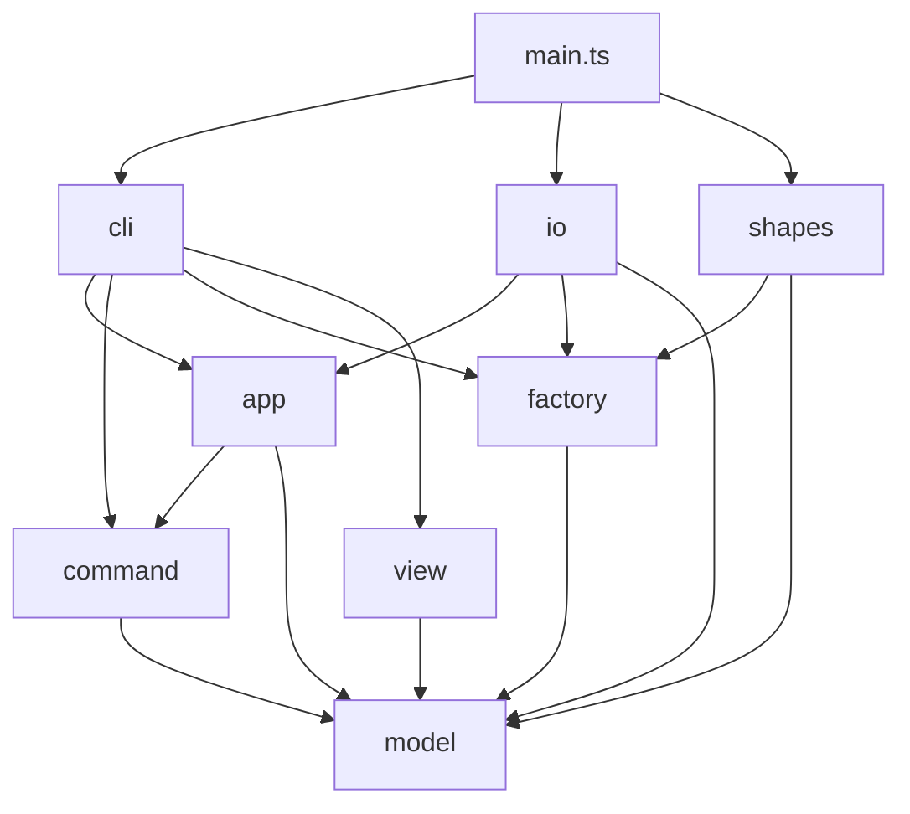

# Lab1 Phase 1：SVG 编辑器（CLI）

## 架构方案

### 1. 模块划分

采用两级划分：第一级是**层**，依赖方向规则按层书写；层内再按内聚程度分**子模块**。具体图形类型单独成为一个纵向模块 `shapes/`，每种类型的“图形类 + 创建器”放在一起。

```text
src/
  model/                内核：图形树 + 文档（不依赖其他任何模块，不认识任何具体图形类型）
    error/              领域错误：EditorError 基类、IdExists、NoSuchShape、NotContainer …
    shape/              Shape、GeometryShape、GroupShape、Numbers
    document/           SvgDocument、IdIndex、Placement
  factory/              图形工厂：类型名 -> 创建器的注册表（第 2 处按名字分派）
    error/              UnknownShapeType、InvalidArguments
  shapes/               内置图形，每种类型一个子模块（图形类 + 创建器）
    rect/ circle/ ellipse/ line/ text/ group/
    BuiltinShapes.ts    把 6 种内置类型注册进 ShapeFactory
  command/              编辑命令 + 撤销历史（Command 模式）
    edit/               各具体命令
    history/            EditCommand 接口、CommandHistory
    error/              group/ungroup/scale/undo 相关错误
  app/                  编辑会话外观 + 端口接口（Facade，依赖倒置）
    error/              NoDocument、FileError
  io/                   SVG 解析/序列化 + 文件读写（实现 app 的端口）
  view/                 tree/show 文本渲染（基于图形自描述）
  cli/                  REPL、分词、命令名分派（第 1 处按名字分派）
    handler/            每条 CLI 命令一个 CliHandler
  main.ts               组装入口（Composition Root）
```

错误类就近放在抛出它的层：只有被多层共用的领域错误留在 `model/error/`。所有错误都继承 `EditorError`，CLI 只按 `Error` 统一打印，不需要认识具体错误类。

#### 各模块职责

- **model**（内核）
  - `shape/Shape`（抽象类，Composite 中的 Component），提供：
    - 身份与结构：`id`、`parent`、`children()`（叶子返回空列表，使容器与叶子可被统一遍历）。
    - 统一操作：`move(dx,dy)`、`scale(f)`、`setAttr/getAttr`、`attrNames()`（`set` 命令的白名单）。
    - **自描述（供序列化）**：`tagName`（SVG 标签名）、`attributes()`（按序输出的 SVG 属性键值对）、`textContent()`（`<text>` 的文本内容，其余类型返回 `undefined`）。
    - **自描述（供显示）**：`summary()`（`tree` 一行中 `tag#id` 之后的属性摘要，如 `x=0 y=0 w=800 h=600 fill=#ffffff`；`g` 返回空串，`box` 插件返回 `(box)`）、`detailLines()`（`show` 输出的属性明细行）。
    - 容器操作 `insertChild/removeChild/indexOf` 也声明在 `Shape` 上（透明式 Composite），叶子调用时抛 `not a container`。
  - `shape/GeometryShape`：带数值几何属性的叶子基类，统一实现 move / scale / 属性读写，子类只声明属性名。
  - `shape/GroupShape`（Composite）：管理子节点的插入、摘出和 z-order；`move/scale` 递归作用到子节点。它属于内核，因为文档根节点就是一个 `GroupShape`。
  - `document/SvgDocument`：包含画布尺寸、根节点和 `IdIndex`，所有改变树结构的操作（insert / detach / relocate）都经过它，由它统一维护 id 唯一性。
  - `error/`：领域错误，只带消息，不带 `error:` 前缀。
  - 约束：不出现 `console`、`fs`、`readline`，也不出现 `switch(tag)`；内部依赖方向为 `document -> shape -> error`。
- **factory**（注册表）
  - `ShapeCreator` 接口：`typeName`、`usage`、`fromArgs(id, args)`（给 CLI 的 `create` 用）、`fromSvg(id, attrs, text)`（给读入 SVG 用）。
  - `AbstractShapeCreator`：模板方法基类，约定参数 = 若干数值几何参数 + 可选的一个样式参数。
  - `ShapeFactory`：用 `Map<string, ShapeCreator>` 注册和查找，查不到时抛出 `unknown shape type`。它本身不认识任何具体类型。
  - 第 2 处按名字分派，**待重构**；是后续 `ShapeProvider` 插件的插槽雏形。
- **shapes**（内置图形）
  - `rect/`、`circle/`、`ellipse/`、`line/`、`text/`：各自包含 `XxxShape`（继承 `GeometryShape`）与 `XxxCreator`（继承 `AbstractShapeCreator`）。
  - `group/`：只有 `GroupCreator`（`GroupShape` 在内核）。
  - `BuiltinShapes`：把 6 种类型注册进 `ShapeFactory`，只由 `main.ts` 调用。
  - 新增类型（如 `box`）= 新增一个子目录 + 在 `main.ts` 注册一行，内核零改动。
- **command**
  - `history/EditCommand` 接口：`execute(): string`（返回成功摘要）、`undo(): string`、`redo(): string`。
  - `edit/` 中的具体命令：`CreateCommand`、`DeleteCommand`、`MoveCommand`、`ScaleCommand`、`SetAttrCommand`、`GroupCommand`、`UngroupCommand`、`AddToCommand`、`ZOrderCommand`。
  - 所有校验在修改状态之前完成，保证“失败不改变状态”；`group` 等涉及多个图形的命令整体作为一个 undo 单元。
  - `history/CommandHistory`：管理 undo/redo 两个栈，执行新命令时清空 redo 栈。`lockByIo()` 清空两个栈并禁止撤销，下一次成功的 `execute` 自动解除锁定。
- **app**
  - `EditorSession`（Facade）：持有当前文档、`CommandHistory` 和当前文件路径；提供 `init/read/save/canvas` 四个文档类操作，`execute(cmd)`、`undo()`、`redo()`，以及“无文档”检查。
  - 端口接口：`DocumentReader`、`DocumentWriter`（输入输出为 `SvgDocument` 和路径）、`WarningSink`（接收“自动补 id”警告）。
- **io**
  - `SvgParser`：把 XML 解析成 model，通过 `ShapeFactory.createFromSvg` 构建图形，缺 id 时补成 `标签名+序号` 并发出警告。
  - `SvgSerializer`：**通用序列化器**，只依赖 `Shape` 的自描述接口（`tagName`、`attributes()`、`textContent()`、`children()`）递归输出 SVG，不认识任何具体图形类。
  - `FileDocumentStore`：实现 app 中的端口，用 `fs` 读写文件，并转换 `cannot read/write file` 错误。
- **view**
  - `TreeRenderer`：递归遍历 `children()`，负责树形连接符（`├──`、`└──`）、缩进和列对齐，每行内容取自 `tagName`、`id` 和 `summary()`。
  - `ShowRenderer`：输出 `tag#id  parent=…` 头行，之后逐行输出 `detailLines()`。
  - 两者都只使用 `Shape` 的自描述接口，不认识任何具体图形类；只负责“怎么排版”，不负责“图形显示什么”。
- **cli**
  - `Repl`：基于 readline，处理 `svg>` 提示符和 `#` 注释。
  - `Tokenizer`：处理双引号包裹的参数。
  - `CommandRegistry`：命令名到 `CliHandler` 的映射。第 1 处按名字分派，**待重构**。
  - `handler/` 中每个 `CliHandler` 负责解析参数、构建 `EditCommand`（通过 factory 创建图形），再交给 session 执行。
  - `ConsoleOutput`：统一加上 `error:` / `warning:` 前缀。

#### 包图（PlantUML）


### 2. 设计模式的选择

课程要求使用 Command。实现中还用了 Composite、Factory、模板方法和 Facade；文件读写通过 app 自己定义的端口做依赖倒置。序列化和 `tree` / `show` 不使用 Visitor，为图形自描述。


| 模式        | 角色在代码中的位置                                                                                                            |
| --------- | -------------------------------------------------------------------------------------------------------------------- |
| Command   | `EditCommand` 是命令；`command/edit/` 下 9 个类是具体命令；`SvgDocument` 和 `Shape` 是接收者；`CommandHistory` 是调用者；`cli/handler/` 是客户端 |
| Composite | `Shape` 是组件，`GroupShape` 是容器，`RectShape` 等叶子经 `GeometryShape` 实现同一套操作                                                |
| Factory   | `ShapeCreator` 是每种类型的工厂，`ShapeFactory` 是按类型名查找的注册表                                                                   |
| 模板方法      | `AbstractShapeCreator` 固定“解析参数再构建”的骨架；`GeometryShape` 固定几何属性的移动、缩放和读写                                                |
| Facade    | `EditorSession` 把当前文档、历史、文件路径和“有没有文档”收成一个入口                                                                          |
| 依赖倒置      | `DocumentReader`、`DocumentWriter`、`WarningSink` 由 app 定义，`FileDocumentStore` 和 `ConsoleOutput` 在外层实现                 |


#### Command

下面以 `move` 为例。其余 8 个具体命令的结构相同，只是转发给接收者的方法不同。


一条编辑命令是一个 undo 单元。`EditCommand` 只有 `execute`、`undo`、`redo`，返回成功摘要，不写控制台。`MoveCommand`、`DeleteCommand`、`GroupCommand` 等各自保存撤销所需的快照：移动和缩放保存几何值，删除和编组保存原来的父节点与下标。`group` 即使收编多个图形，也只生成一个 `GroupCommand`，撤销一次就全部还原。

`CommandHistory` 不认识任何具体命令。它先调用 `execute`，成功后才压入 undo 栈并清空 redo 栈；执行中抛出的错误不会入栈，因此失败命令不改变历史。`init`、`read`、成功的 `save` 和修改尺寸的 `canvas` 调用 `lockByIo()`，清空两个栈并禁止跨越这次文档操作撤销。下一条成功的编辑命令会自动解除锁定，并成为新的历史起点。

CLI 处理器只解析参数并构造命令。例如 `MoveHandler` 把文本变成数字后，通过 `EditorSession.execute` 得到当前文档，再创建 `MoveCommand`。会话负责检查“是否已有文档”，历史负责入栈，命令负责修改图形。以后 GUI 可以复用同一批命令，不必经过文本解析。

#### Composite

下面以 `move` 为例。`circle`、`ellipse`、`line`、`text` 与 `RectShape` 相同，都经 `GeometryShape` 实现 `move`。


`Shape` 同时声明叶子和容器都会用到的操作：`move`、`scale`、`setAttr`，以及 `children()`、`insertChild`、`removeChild`。这是透明式 Composite。叶子的 `children()` 返回空列表，对叶子调用插入或摘除会抛出 `not a container`。因此 `DeleteCommand`、`TreeRenderer` 和 `SvgSerializer` 都可以只依赖 `Shape`，不必判断对象是矩形还是分组。

`GroupShape.move` 和 `scale` 递归到每个子节点，所以 `move node2 0 100` 会带动组内的矩形和文字。文档根节点也是一个 `GroupShape`，但它表示 `<svg>` 本身，不进入 id 索引，也不能被 `ungroup`。`isComposite()` 预留给 `box` 这类内部结构归插件所有的容器；当前内置的 `g` 返回 `false`，`UngroupCommand` 遇到 `true` 时拒绝解散。

#### Factory 与模板方法

下面以 `create rect` 为例。`circle`、`ellipse`、`line`、`g` 与 `RectCreator` 相同，只实现 `build`。


创建图形有两个入口，但都落到同一个 `ShapeCreator`：`fromArgs` 服务 CLI 的 `create`，`fromSvg` 服务读入 SVG。`ShapeFactory` 用 `Map<string, ShapeCreator>` 按类型名查找，找不到就抛出 `unknown shape type`。工厂本身不引用 `RectShape` 等具体类。六种内置类型由 `BuiltinShapes` 注册，而 `BuiltinShapes` 只允许 `main.ts` 引用。

`AbstractShapeCreator` 把重复流程固定下来：检查参数个数、把几何参数解析成数字、调用子类的 `build`，再按类型写入可选的 `fill` 或 `stroke`。`RectCreator`、`CircleCreator` 等只声明属性名并实现 `build`。`text` 的第三个参数是字符串内容，不符合这个数值模板，所以 `TextCreator` 覆盖了 `fromArgs`，读入 SVG 时仍复用基类的 `fromSvg`。

`GeometryShape` 是另一处模板方法。它按 SVG 属性名保存数值，统一实现移动、缩放、属性读写和序列化；具体叶子只声明哪些键属于 x 或 y。这样新增一种普通几何图形时，不需要再写一遍 `move` 和 `setAttr`。

`ShapeFactory` 和 CLI 的 `CommandRegistry` 是全项目仅有的两处按名字分派，代码里都标注为待重构。它们现在是可替换实现的注册表，还不是能够动态加载的插件框架。

#### Facade 与依赖倒置

下面以 `read` 为例。`init`、`save`、`canvas`、`execute`、`undo`、`redo` 也同样只从 `EditorSession` 进入。


`EditorSession` 是外层访问编辑器的唯一入口。它隐藏了三件易变的事：当前文档可能不存在、撤销栈何时被文档操作锁住、文件路径是显式传入还是沿用上次的路径。`init`、`read`、`save`、`canvas`、`execute`、`undo`、`redo` 都从这里进入。`tree` 和 `show` 不修改状态，通过 `inspect` 只读访问文档。

会话不直接依赖文件系统。它依赖自己声明的 `DocumentReader`、`DocumentWriter` 和 `WarningSink`。`FileDocumentStore` 用 `fs` 实现前两个端口，并把系统错误转换成 `cannot read file` 或 `cannot write file`；XML 内容错误则原样抛出，不伪装成文件错误。`ConsoleOutput` 同时实现 CLI 的 `TextOutput` 和 `WarningSink`，统一添加 `error:` 与 `warning:` 前缀。测试可以用内存桩替换这些实现，app 和 command 都不用改。

### 3. 依赖方向规则

箭头表示“可以依赖”，图中没有的依赖一律禁止：




1. **model 不依赖任何模块**，也不引用 Node 内置模块。理由：图形树会被 CLI、agent、鼠标三种通道共用，必须保持纯净，便于单元测试。model 内部依赖方向为 `document -> shape -> error`：图形不知道文档的存在，错误类不依赖任何东西。
2. **command 只依赖 model**。命令不关心来源是文本还是鼠标，也不做任何输出。理由：以后 GUI 可以直接复用。
3. **app 只依赖 model 和 command，通过自己定义的端口接口使用 IO**，不能 import io。理由：依赖倒置，文件、网络、内存存储都可替换，测试时可注入假实现。
4. **io 依赖 app 的端口和 model/factory，属于最外层的“插件”**，不允许被 app、command、model 引用。io 只通过 `Shape` 的自描述接口读取图形，不依赖任何具体图形子类。
5. **view 只依赖 model**，通过 `Shape` 的自描述接口只读遍历图形树，不修改状态。
6. **cli 位于最外层**，可依赖 app、command、factory、view，但不能直接 import io，也不能绕过 session 直接修改 model。
7. **只有 main.ts 可以同时看到所有模块，也只有它可以引用 shapes**，负责通过 `BuiltinShapes` 创建 `ShapeFactory`，以及创建 `FileDocumentStore`、`EditorSession` 和 `Repl` 并连接。理由：这是“内核不认识具体图形类型”的机械保证——io、view、command、cli 一旦 import `RectShape` 这类具体类就会被检查拦下。
8. **shapes 只依赖 factory 和 model，各图形子模块之间互不引用**。理由：每种图形是一个可单独增删的单元，为插件化阶段做准备。
9. **全局不允许循环依赖**；同一模块内部可以互相引用。
10. 按名字分派只允许出现在 `cli/CommandRegistry` 和 `factory/ShapeFactory` 两处。

检查手段：`dependency-cruiser`，规则见 `.dependency-cruiser.cjs`，执行 `npm run lint:deps`。

### 4. 变化点假设

- **新增图形类型（如** `box` **插件）**：新增 `shapes/box/` 子模块并在 `main.ts` 注册即可。序列化与 tree/show 显示都已改为图形自描述，序列化器和渲染器无需修改；`box` 的 `data-kind` 标记由其 `attributes()` 输出，`g#n1 (box)` 的类型标注由其 `summary()` 输出。代价是 model 中的 `Shape` 需要知道 SVG 的标签名和属性名，并且承担了一部分显示文本的职责，即 SVG 词汇和显示格式进入了 model。决定接受这一点：SVG 本身就是本领域的原生格式，不为“可能换成别的格式”预留抽象。
- **显示文本的职责边界**：`summary()`/`detailLines()` 返回的是 CLI 文本。若以后有 GUI 需要结构化属性展示，可改为返回键值对，由各通道自行排版；目前 CLI 是唯一通道，暂不预留。
- **命令直接返回摘要字符串**：简单，但一部分展示职责落在了 command。若以后要多语言或有 GUI，可改成结构化的 `CommandResult`。
- **暂不引入 Observer**：CLI 不需要；GUI 阶段需要刷新画面时，再在 `SvgDocument` 上加事件。
- **新增 CLI 命令**：加一个 `command/edit` 中的命令类和一个 `cli/handler`，再在 `Cli.createDefault` 里 `register` 一行。命令只改 model，处理器只解析参数并交给 `EditorSession`。`CommandRegistry` 与 `ShapeFactory` 一样仍是按名字分派，代码中标注为待重构。
- **另一种输入通道（GUI、agent）**：`EditCommand` 不解析文本、也不写控制台，`EditorSession` 是访问当前文档和历史的唯一入口，因此新通道可以复用同一批命令。鼠标点选和命中检测当前不存在，没有为它们预留接口。
- **存储介质**：`DocumentReader`、`DocumentWriter` 由 app 定义，`FileDocumentStore` 只是用 `fs` 做的一种实现。换成内存或网络存储时，替换注入给 `EditorSession` 的实现即可，app 和 command 不用改。

## 过程记录

- **序列化方案由 Visitor 改为图形自描述**：AI 给出的初稿选用 Visitor，同时在取舍中指出它与 `box` 插件化（内核新增代码为 0）的目标冲突。复核后决定在方案阶段就改为自描述，避免后期重构。起初 view 仍保留 Visitor（每种图形的显示格式不同），但这会让新增类型时仍需修改渲染器，与序列化改动的目的自相矛盾，随后也一并改为自描述（`summary()` / `detailLines()`），整个方案不再使用 Visitor。
- **从“只按层分”到“层 + 子模块 + 纵向的 shapes 模块”**：让 AI 实现完 model 和 factory 两层后发现，`model/` 一层堆了 28 个文件（图形内核、文档、17 个错误类混在一起），且同一种图形被拆在两层（`RectShape` 在 model、`RectCreator` 在 factory），新增类型要同时改两层，与插件化目标不符。于是重构为：层内按内聚分子模块；具体图形与其创建器合并为 `shapes/<type>/`，并新增“只有 main.ts 可以引用 shapes”的规则；错误类就近放到抛出它的层。之所以能加上这条规则，是因为此前已把序列化和显示改为图形自描述，io / view / command 本来就不需要认识具体图形类。重构后用临时违规文件验证了新规则全部生效。

## 一致性自查

- **模块划分**：`src/` 的目录与第 1 节一致。`model` 内是 `error`、`shape`、`document`；`shapes/` 下每种图形一个子目录，图形类与创建器放在一起；`GroupShape` 留在 `model/shape`，因为文档根就是一个组。`command` 分为 `edit`、`history`、`error`，`app` 只保留会话和端口，`cli/handler` 一条命令一个类。
- **依赖方向**：`npm run lint:deps` 通过。`.dependency-cruiser.cjs` 与第 3 节的规则对应，包括 model 不引用其他模块和 Node 内置模块、command 只依赖 model、app 不引用 io、cli 不引用 io 和 model、只有 `main.ts` 引用 `shapes/`、各图形子模块互不引用、没有循环依赖。
- **设计模式**：第 2 节列出的角色都在代码里。`command/edit/` 有 9 个具体命令，都实现 `EditCommand`；`CommandHistory` 只依赖这个接口。`Shape` 上声明了容器操作，叶子调用时抛出 `not a container`。`ShapeFactory` 不引用 `RectShape` 等具体类，六种内置类型由 `BuiltinShapes` 注册。`EditorSession` 是唯一入口，`FileDocumentStore` 实现 `DocumentReader` 和 `DocumentWriter`。序列化和 `tree` / `show` 只调用 `Shape` 的自描述方法，没有 Visitor。按名字分派只有 `CommandRegistry.dispatch` 和 `ShapeFactory` 的查找两处。
- **类图省略了会话**：Command 类图把 `MoveHandler` 直接画到 `CommandHistory`，用来标出客户端、调用者和命令。代码里处理器只调用 `EditorSession.execute`，再由会话进入历史栈。这条路径写在 Command 一节的正文和 Facade 图里。依赖方向以包图和 dependency-cruiser 为准，类图只表示一次调用里的模式角色。
- **一处文档与实现不符 (后面已改正)**：第 1 节写 `CommandHistory` 提供 `unlock()`。实现中没有这个方法。`lockByIo()` 清空两个栈，下一次成功的编辑命令在 `execute` 里解除锁定，并成为新的历史起点。

## 质量保证手段

三条命令覆盖测试、类型和依赖方向：`npm test`（vitest）、`npm run build`（`tsc`，`strict: true`）、`npm run lint:deps`（dependency-cruiser）。

- **TDD**：每一层先写测试并单独提交，确认失败后再写实现。因此提交历史上都是 `test(...)` 与 `feat(...)` 成对出现。测试目录与 `src/` 的层一一对应。
- **每层锁住的行为**：
  - model：图形树、id 唯一性、叶子不是容器、`move` / `scale` 的作用范围。
  - factory 与 shapes：注册表查不到类型时抛错；`fromArgs` 与 `fromSvg` 两条创建路径。
  - command：每条编辑命令的执行、撤销和重做；非法输入不改变文档；历史栈在文档操作之后锁定，失败的命令不入栈。
  - app：会话的 `init` / `read` / `save` / `execute`。`DocumentReader`、`DocumentWriter`、`WarningSink` 用桩替换，会话测试不碰文件系统。
  - io：SVG 解析与序列化，以及临时目录中的文件读写。
  - view：`tree` 的连接符与列对齐，`show` 的明细行。
  - cli：分词、`error:` / `warning:` 前缀、REPL 和命令分派。
- **实验会话回放**：`test/cli/Transcript.test.ts` 通过 `createCli` 回放两段会话，一段是完整的编辑、撤销和文件往返，一段是用组合作节点的流程图。断言的是 stdout 和 stderr 的全文。临时文件放在系统临时目录，不修改进程的工作目录。真实地在程序上运行实验会话回放，也得到了和要求文档中相同的结果。
- **依赖方向由工具检查**：`.dependency-cruiser.cjs` 把第 3 节的规则写成禁止项，包括禁止循环依赖、model 不引用 Node 内置模块、只有 `main.ts` 可以引用 `shapes/`。规则写好后用临时违规文件确认能被拦住，再删掉这些文件。

