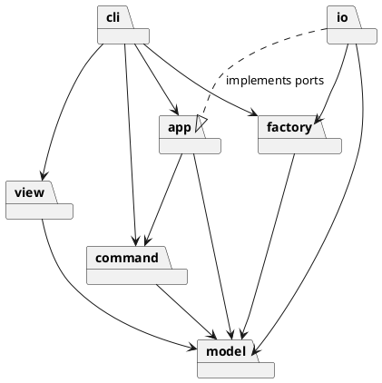
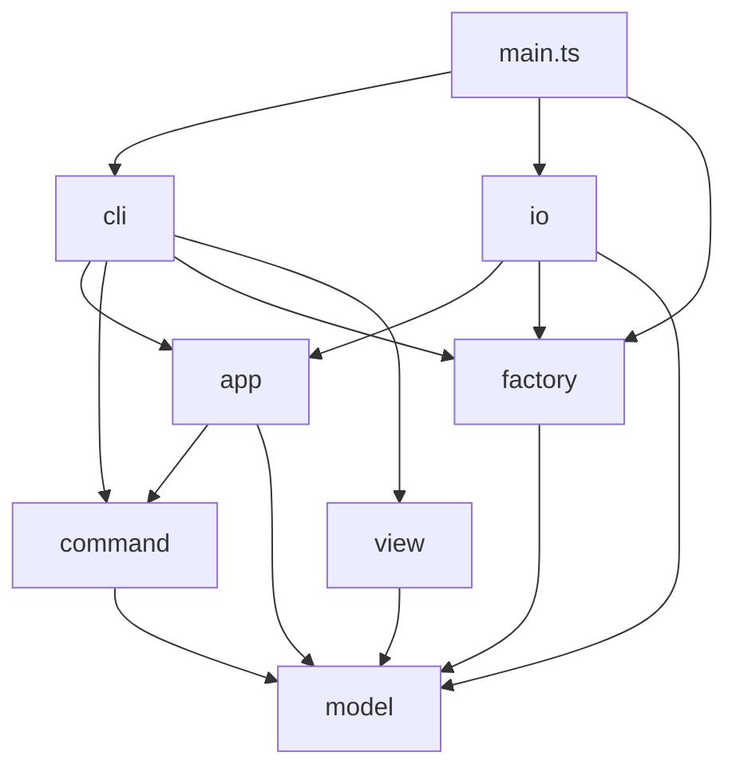

# Lab1 Phase 1：SVG 編輯器（CLI）

## 架構方案

### 1. 模塊劃分

```text
src/
  model/        領域模型：圖形樹 + 文檔（不依賴其他任何模塊）
  factory/      圖形工廠：類型名 -> 圖形類（第 2 處按名字分派）
  command/      編輯命令 + 撤銷歷史（Command 模式）
  app/          編輯會話外觀 + 端口接口（Facade，依賴倒置）
  io/           SVG 解析/序列化 + 文件讀寫（實現 app 的端口）
  view/         tree/show 文本渲染（Visitor）
  cli/          REPL、分詞、命令名分派（第 1 處按名字分派）
  main.ts       組裝入口（Composition Root）
```

#### 各模塊職責

- **model**
  - `Shape`（抽象類，Composite 中的 Component）：提供 `id`、`parent`、`move(dx,dy)`、`scale(f)`、`setAttr/getAttr`、`attrNames()`（`set` 命令的白名單）、`accept(visitor)`。
  - 葉子圖形：`RectShape`、`CircleShape`、`EllipseShape`、`LineShape`、`TextShape`。
  - `GroupShape`（Composite）：管理子節點的插入、摘出和 z-order；`move/scale` 遞歸作用到子節點。
  - `SvgDocument`：包含畫布尺寸、根節點和 `IdIndex`，負責 id 唯一性和按 id 查找。
  - `ShapeVisitor` 接口，以及 `EditorError` 系列錯誤類（`NoSuchShapeError`、`IdExistsError` 等，只帶消息，不帶 `error:` 前綴）。
  - 約束：不出現 `console`、`fs`、`readline`，也不出現 `switch(tag)`。
- **factory**
  - `ShapeCreator` 接口：`typeName`、`fromArgs(id, args)`（給 CLI 的 `create` 用）、`fromSvg(id, attrs)`（給讀入 SVG 用）。
  - `ShapeFactory`：用 `Map<string, ShapeCreator>` 註冊和查找，查不到時拋出 `unknown shape type`。
  - 第 2 處按名字分派，**待重構**；是後續 `ShapeProvider` 插件的插槽雛形。
- **command**
  - `EditCommand` 接口：`execute(): string`（返回成功摘要）、`undo(): string`、`redo(): string`。
  - 具體命令：`CreateCommand`、`DeleteCommand`、`MoveCommand`、`ScaleCommand`、`SetAttrCommand`、`GroupCommand`、`UngroupCommand`、`AddToCommand`、`ZOrderCommand`。
  - 所有校驗在修改狀態之前完成，保證「失敗不改變狀態」；`group` 等涉及多個圖形的命令整體作為一個 undo 單元。
  - `CommandHistory`：管理 undo/redo 兩個棧，執行新命令時清空 redo 棧，提供 `lockByIo()` 和 `unlock()`。
- **app**
  - `EditorSession`（Facade）：持有當前文檔、`CommandHistory` 和當前文件路徑；提供 `init/read/save/canvas` 四個文檔類操作，`execute(cmd)`、`undo()`、`redo()`，以及「無文檔」檢查。
  - 端口接口：`DocumentReader`、`DocumentWriter`（輸入輸出為 `SvgDocument` 和路徑）、`WarningSink`（接收「自動補 id」警告）。
- **io**
  - `SvgParser`：把 XML 解析成 model，通過 `ShapeFactory.fromSvg` 構建圖形，缺 id 時補成 `標籤名+序號` 並發出警告。
  - `SvgSerializer`：實現 `ShapeVisitor`，輸出 SVG 文本。
  - `FileDocumentStore`：實現 app 中的端口，用 `fs` 讀寫文件，並轉換 `cannot read/write file` 錯誤。
- **view**
  - `TreeRenderer`、`ShowRenderer`：實現 `ShapeVisitor`，生成實驗要求 5.1、5.2 節規定的文本。
- **cli**
  - `Repl`：基於 readline，處理 `svg>` 提示符和 `#` 註釋。
  - `Tokenizer`：處理雙引號包裹的參數。
  - `CommandRegistry`：命令名到 `CliHandler` 的映射。第 1 處按名字分派，**待重構**。
  - 每個 `CliHandler` 負責解析參數、構建 `EditCommand`（通過 factory 創建圖形），再交給 session 執行。
  - `ConsoleOutput`：統一加上 `error:` / `warning:` 前綴。

#### 包圖（PlantUML）



### 2. 設計模式的選擇

（待補充：Command、Composite、Visitor、Facade、Factory 的具體落地說明。）

### 3. 依賴方向規則

箭頭表示「可以依賴」，圖中沒有的依賴一律禁止：



1. **model 不依賴任何模塊**，也不引用 Node 內置模塊。理由：圖形樹會被 CLI、agent、鼠標三種通道共用，必須保持純淨，便於單元測試。
2. **command 只依賴 model**。命令不關心來源是文本還是鼠標，也不做任何輸出。理由：以後 GUI 可以直接複用。
3. **app 只依賴 model 和 command，通過自己定義的端口接口使用 IO**，不能 import io。理由：依賴倒置，文件、網絡、內存存儲都可替換，測試時可注入假實現。
4. **io 依賴 app 的端口和 model/factory，屬於最外層的「插件」**，不允許被 app、command、model 引用。
5. **view 只依賴 model**，以 Visitor 形式只讀遍歷圖形樹，不修改狀態。
6. **cli 位於最外層**，可依賴 app、command、factory、view，但不能直接 import io，也不能繞過 session 直接修改 model。
7. **只有 main.ts 可以同時看到所有模塊**，負責創建 `FileDocumentStore`、`ShapeFactory`（註冊 6 種內置類型）、`EditorSession` 和 `Repl` 並連接。
8. **全局不允許循環依賴**；同一模塊內部可以互相引用。
9. 按名字分派只允許出現在 `cli/CommandRegistry` 和 `factory/ShapeFactory` 兩處。

檢查手段：`dependency-cruiser`，規則見 `.dependency-cruiser.cjs`，執行 `npm run lint:deps`。

### 4. 變化點假設

- **序列化：Visitor 還是圖形自描述**。Visitor 讓 model 不涉及 SVG 格式，但新增類型時要修改 Visitor，與 `box` 插件化目標衝突。另一種做法是 `Shape` 暴露 `tagName` 和 `attributes()`，由序列化器通用處理。目前先選 Visitor，記為插件化階段的重構點。
- **命令直接返回摘要字符串**：簡單，但一部分展示職責落在了 command。若以後要多語言或有 GUI，可改成結構化的 `CommandResult`。
- **暫不引入 Observer**：CLI 不需要；GUI 階段需要刷新畫面時，再在 `SvgDocument` 上加事件。

（待補充：其餘變化點。）

## 過程記錄

（待補充。）

## 一致性自查

（實現完成後補充。）

## 質量保證手段

（實現完成後補充。）
