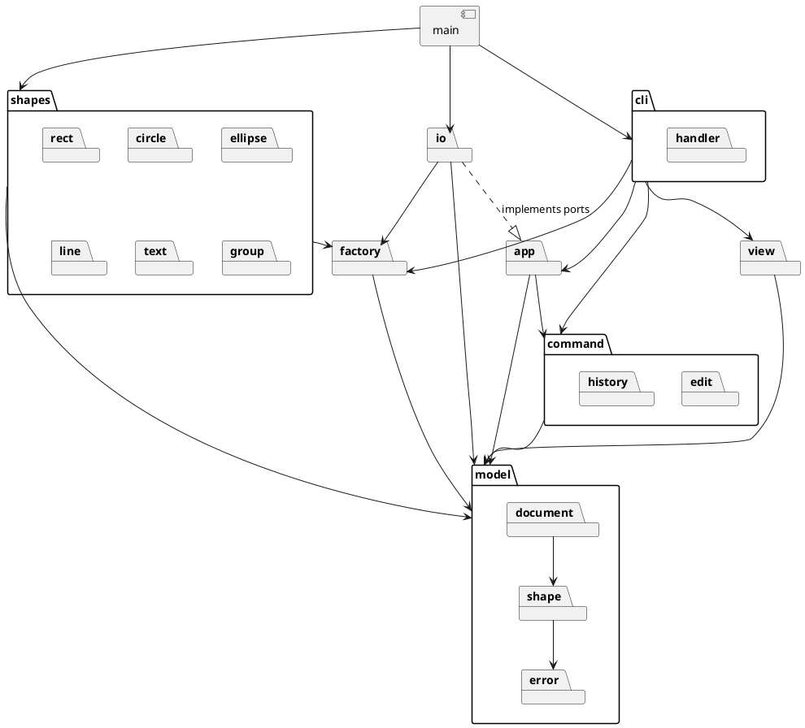
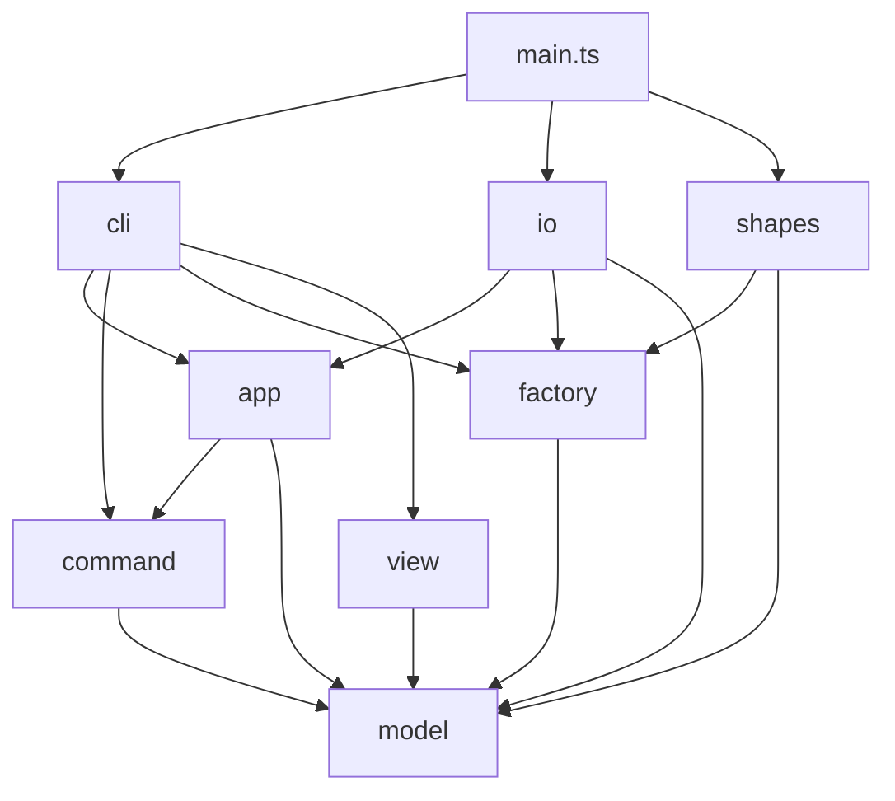

# Lab1 Phase 1：SVG 编辑器（CLI）

## 架构方案

### 1. 模块划分

采用两级划分：第一级是**层**，依赖方向规则按层书写；层内再按内聚程度分**子模块**。具体图形类型单独成为一个纵向模块 `shapes/`，每种类型的“图形类 + 创建器”放在一起。

```text
src/
  model/                内核：图形树 + 文档（不依赖其他任何模块，不认识任何具体图形类型）
    error/              领域错误：EditorError 基类、IdExists、NoSuchShape、NotContainer …
    shape/              Shape、GeometryShape、GroupShape、Numbers
    document/           SvgDocument、IdIndex、Placement
  factory/              图形工厂：类型名 -> 创建器的注册表（第 2 处按名字分派）
    error/              UnknownShapeType、InvalidArguments
  shapes/               内置图形，每种类型一个子模块（图形类 + 创建器）
    rect/ circle/ ellipse/ line/ text/ group/
    BuiltinShapes.ts    把 6 种内置类型注册进 ShapeFactory
  command/              编辑命令 + 撤销历史（Command 模式）
    edit/               各具体命令
    history/            EditCommand 接口、CommandHistory
    error/              group/ungroup/scale/undo 相关错误
  app/                  编辑会话外观 + 端口接口（Facade，依赖倒置）
    error/              NoDocument、FileError
  io/                   SVG 解析/序列化 + 文件读写（实现 app 的端口）
  view/                 tree/show 文本渲染（基于图形自描述）
  cli/                  REPL、分词、命令名分派（第 1 处按名字分派）
    handler/            每条 CLI 命令一个 CliHandler
  main.ts               组装入口（Composition Root）
```

错误类就近放在抛出它的层：只有被多层共用的领域错误留在 `model/error/`。所有错误都继承 `EditorError`，CLI 只按 `Error` 统一打印，不需要认识具体错误类。

#### 各模块职责

- **model**（内核）
  - `shape/Shape`（抽象类，Composite 中的 Component），提供：
    - 身份与结构：`id`、`parent`、`children()`（叶子返回空列表，使容器与叶子可被统一遍历）。
    - 统一操作：`move(dx,dy)`、`scale(f)`、`setAttr/getAttr`、`attrNames()`（`set` 命令的白名单）。
    - **自描述（供序列化）**：`tagName`（SVG 标签名）、`attributes()`（按序输出的 SVG 属性键值对）、`textContent()`（`<text>` 的文本内容，其余类型返回 `undefined`）。
    - **自描述（供显示）**：`summary()`（`tree` 一行中 `tag#id` 之后的属性摘要，如 `x=0 y=0 w=800 h=600 fill=#ffffff`；`g` 返回空串，`box` 插件返回 `(box)`）、`detailLines()`（`show` 输出的属性明细行）。
    - 容器操作 `insertChild/removeChild/indexOf` 也声明在 `Shape` 上（透明式 Composite），叶子调用时抛 `not a container`。
  - `shape/GeometryShape`：带数值几何属性的叶子基类，统一实现 move / scale / 属性读写，子类只声明属性名。
  - `shape/GroupShape`（Composite）：管理子节点的插入、摘出和 z-order；`move/scale` 递归作用到子节点。它属于内核，因为文档根节点就是一个 `GroupShape`。
  - `document/SvgDocument`：包含画布尺寸、根节点和 `IdIndex`，所有改变树结构的操作（insert / detach / relocate）都经过它，由它统一维护 id 唯一性。
  - `error/`：领域错误，只带消息，不带 `error:` 前缀。
  - 约束：不出现 `console`、`fs`、`readline`，也不出现 `switch(tag)`；内部依赖方向为 `document -> shape -> error`。
- **factory**（注册表）
  - `ShapeCreator` 接口：`typeName`、`usage`、`fromArgs(id, args)`（给 CLI 的 `create` 用）、`fromSvg(id, attrs, text)`（给读入 SVG 用）。
  - `AbstractShapeCreator`：模板方法基类，约定参数 = 若干数值几何参数 + 可选的一个样式参数。
  - `ShapeFactory`：用 `Map<string, ShapeCreator>` 注册和查找，查不到时抛出 `unknown shape type`。它本身不认识任何具体类型。
  - 第 2 处按名字分派，**待重构**；是后续 `ShapeProvider` 插件的插槽雏形。
- **shapes**（内置图形）
  - `rect/`、`circle/`、`ellipse/`、`line/`、`text/`：各自包含 `XxxShape`（继承 `GeometryShape`）与 `XxxCreator`（继承 `AbstractShapeCreator`）。
  - `group/`：只有 `GroupCreator`（`GroupShape` 在内核）。
  - `BuiltinShapes`：把 6 种类型注册进 `ShapeFactory`，只由 `main.ts` 调用。
  - 新增类型（如 `box`）= 新增一个子目录 + 在 `main.ts` 注册一行，内核零改动。
- **command**
  - `history/EditCommand` 接口：`execute(): string`（返回成功摘要）、`undo(): string`、`redo(): string`。
  - `edit/` 中的具体命令：`CreateCommand`、`DeleteCommand`、`MoveCommand`、`ScaleCommand`、`SetAttrCommand`、`GroupCommand`、`UngroupCommand`、`AddToCommand`、`ZOrderCommand`。
  - 所有校验在修改状态之前完成，保证“失败不改变状态”；`group` 等涉及多个图形的命令整体作为一个 undo 单元。
  - `history/CommandHistory`：管理 undo/redo 两个栈，执行新命令时清空 redo 栈，提供 `lockByIo()` 和 `unlock()`。
- **app**
  - `EditorSession`（Facade）：持有当前文档、`CommandHistory` 和当前文件路径；提供 `init/read/save/canvas` 四个文档类操作，`execute(cmd)`、`undo()`、`redo()`，以及“无文档”检查。
  - 端口接口：`DocumentReader`、`DocumentWriter`（输入输出为 `SvgDocument` 和路径）、`WarningSink`（接收“自动补 id”警告）。
- **io**
  - `SvgParser`：把 XML 解析成 model，通过 `ShapeFactory.createFromSvg` 构建图形，缺 id 时补成 `标签名+序号` 并发出警告。
  - `SvgSerializer`：**通用序列化器**，只依赖 `Shape` 的自描述接口（`tagName`、`attributes()`、`textContent()`、`children()`）递归输出 SVG，不认识任何具体图形类。
  - `FileDocumentStore`：实现 app 中的端口，用 `fs` 读写文件，并转换 `cannot read/write file` 错误。
- **view**
  - `TreeRenderer`：递归遍历 `children()`，负责树形连接符（`├──`、`└──`）、缩进和列对齐，每行内容取自 `tagName`、`id` 和 `summary()`。
  - `ShowRenderer`：输出 `tag#id  parent=…` 头行，之后逐行输出 `detailLines()`。
  - 两者都只使用 `Shape` 的自描述接口，不认识任何具体图形类；只负责“怎么排版”，不负责“图形显示什么”。
- **cli**
  - `Repl`：基于 readline，处理 `svg>` 提示符和 `#` 注释。
  - `Tokenizer`：处理双引号包裹的参数。
  - `CommandRegistry`：命令名到 `CliHandler` 的映射。第 1 处按名字分派，**待重构**。
  - `handler/` 中每个 `CliHandler` 负责解析参数、构建 `EditCommand`（通过 factory 创建图形），再交给 session 执行。
  - `ConsoleOutput`：统一加上 `error:` / `warning:` 前缀。


#### 包图（PlantUML）




### 2. 设计模式的选择

（待补充：Command、Composite、Facade、Factory 的具体落地说明。）

序列化与显示的设计决策：采用**图形自描述**而非 Visitor。每个 `Shape` 自己说明“我是什么标签、有哪些属性、有无文本内容、有哪些子节点、在 tree/show 中如何显示”，`SvgSerializer`、`TreeRenderer`、`ShowRenderer` 只做通用的递归遍历与排版。这样新增图形类型（包括后续的 `box` 插件）时，序列化器和渲染器都无需修改，符合“内核为插件新增的代码为 0”的目标。本方案不使用 Visitor。

### 3. 依赖方向规则

箭头表示“可以依赖”，图中没有的依赖一律禁止：




1. **model 不依赖任何模块**，也不引用 Node 内置模块。理由：图形树会被 CLI、agent、鼠标三种通道共用，必须保持纯净，便于单元测试。model 内部依赖方向为 `document -> shape -> error`：图形不知道文档的存在，错误类不依赖任何东西。
2. **command 只依赖 model**。命令不关心来源是文本还是鼠标，也不做任何输出。理由：以后 GUI 可以直接复用。
3. **app 只依赖 model 和 command，通过自己定义的端口接口使用 IO**，不能 import io。理由：依赖倒置，文件、网络、内存存储都可替换，测试时可注入假实现。
4. **io 依赖 app 的端口和 model/factory，属于最外层的“插件”**，不允许被 app、command、model 引用。io 只通过 `Shape` 的自描述接口读取图形，不依赖任何具体图形子类。
5. **view 只依赖 model**，通过 `Shape` 的自描述接口只读遍历图形树，不修改状态。
6. **cli 位于最外层**，可依赖 app、command、factory、view，但不能直接 import io，也不能绕过 session 直接修改 model。
7. **只有 main.ts 可以同时看到所有模块，也只有它可以引用 shapes**，负责通过 `BuiltinShapes` 创建 `ShapeFactory`，以及创建 `FileDocumentStore`、`EditorSession` 和 `Repl` 并连接。理由：这是“内核不认识具体图形类型”的机械保证——io、view、command、cli 一旦 import `RectShape` 这类具体类就会被检查拦下。
8. **shapes 只依赖 factory 和 model，各图形子模块之间互不引用**。理由：每种图形是一个可单独增删的单元，为插件化阶段做准备。
9. **全局不允许循环依赖**；同一模块内部可以互相引用。
10. 按名字分派只允许出现在 `cli/CommandRegistry` 和 `factory/ShapeFactory` 两处。

检查手段：`dependency-cruiser`，规则见 `.dependency-cruiser.cjs`，执行 `npm run lint:deps`。

### 4. 变化点假设

- **新增图形类型（如 `box` 插件）**：新增 `shapes/box/` 子模块并在 `main.ts` 注册即可。序列化与 tree/show 显示都已改为图形自描述，序列化器和渲染器无需修改；`box` 的 `data-kind` 标记由其 `attributes()` 输出，`g#n1 (box)` 的类型标注由其 `summary()` 输出。代价是 model 中的 `Shape` 需要知道 SVG 的标签名和属性名，并且承担了一部分显示文本的职责，即 SVG 词汇和显示格式进入了 model。决定接受这一点：SVG 本身就是本领域的原生格式，不为“可能换成别的格式”预留抽象。
- **显示文本的职责边界**：`summary()`/`detailLines()` 返回的是 CLI 文本。若以后有 GUI 需要结构化属性展示，可改为返回键值对，由各通道自行排版；目前 CLI 是唯一通道，暂不预留。
- **命令直接返回摘要字符串**：简单，但一部分展示职责落在了 command。若以后要多语言或有 GUI，可改成结构化的 `CommandResult`。
- **暂不引入 Observer**：CLI 不需要；GUI 阶段需要刷新画面时，再在 `SvgDocument` 上加事件。

（待补充：其余变化点。）

## 过程记录

- **序列化方案由 Visitor 改为图形自描述**：AI 给出的初稿选用 Visitor，同时在取舍中指出它与 `box` 插件化（内核新增代码为 0）的目标冲突。复核后决定在方案阶段就改为自描述，避免后期重构。起初 view 仍保留 Visitor（每种图形的显示格式不同），但这会让新增类型时仍需修改渲染器，与序列化改动的目的自相矛盾，随后也一并改为自描述（`summary()` / `detailLines()`），整个方案不再使用 Visitor。
- **从“只按层分”到“层 + 子模块 + 纵向的 shapes 模块”**：实现完 model 和 factory 两层后发现，`model/` 一层堆了 28 个文件（图形内核、文档、17 个错误类混在一起），且同一种图形被拆在两层（`RectShape` 在 model、`RectCreator` 在 factory），新增类型要同时改两层，与插件化目标不符。于是重构为：层内按内聚分子模块；具体图形与其创建器合并为 `shapes/<type>/`，并新增“只有 main.ts 可以引用 shapes”的规则；错误类就近放到抛出它的层。之所以能加上这条规则，是因为此前已把序列化和显示改为图形自描述，io / view / command 本来就不需要认识具体图形类。重构后用临时违规文件验证了新规则全部生效。

（其余待补充。）

## 一致性自查

（实现完成后补充。）

## 质量保证手段

（实现完成后补充。）